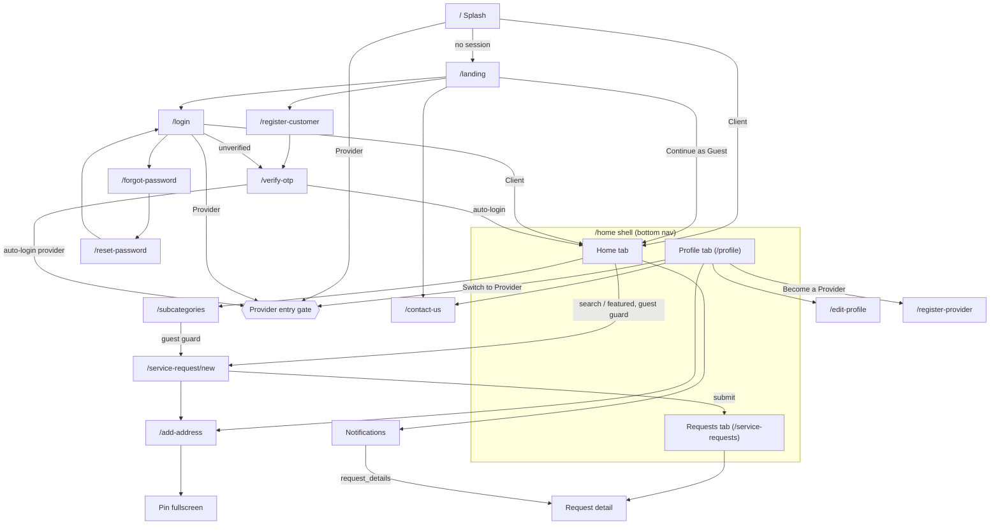
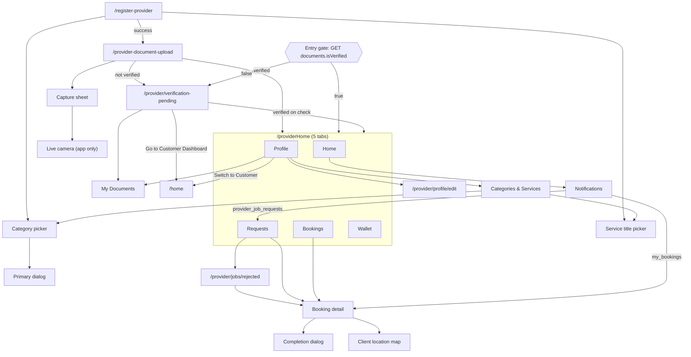

# Sahulat Ghar Tak: web parity spec

**Audience:** the developer building the ASP.NET Core 8 MVC website (Razor, Bootstrap, cookie login), who can't see the Flutter repo.
**Source:** this Flutter repo at Android `1.0.6+12` / iOS `1.0.8+12` (`pubspec.yaml:6-8`), and `api.txt` v3.44 (2026-10-21).
**Rule:** every claim cites a `file:line` in the Flutter repo (or an `api.txt` line). "UNVERIFIED" marks anything the code doesn't prove. This file has no secrets, keys, passwords or personal contact details. Contact Us values are referenced by file only.

Layout of this file:

| Part | Contents |
|---|---|
| Part A (sections 1–11) | Inventory, navigation map, workflows, statuses, auth/session, API coverage, design tokens, business rules, risks, differences from the current web, build order |
| Part B | Client screens (Home, browse, request form, my requests, request detail, profile, addresses) |
| Part C | Provider screens (entry gate, registration, documents, pending, dashboard tabs, booking detail, wallet, profile, categories) |
| Part D | Splash, landing, login, signup, OTP, password reset, contact, notifications inbox, delete account, version gate |

---

## 1. Screen inventory

Priority: **P0** = core flow, **P1** = important, **P2** = nice to have, **SKIP** = app-only.
App routes are the names in `SahulatApp.routes` (`lib/main.dart:160-195`). "—" means the screen is pushed directly with `MaterialPageRoute` and has no route name.

| # | Screen | Role | App route | Proposed web route | Priority | Part |
|---|---|---|---|---|---|---|
| S1 | Splash | All | `/` | (middleware) | SKIP | D |
| S2 | Landing | Guest | `/landing` | `/` (exists) | P0 (exists) | D |
| S3 | Login | Guest | `/login` | `/login` (exists) | P0 (exists) | D |
| S4 | Customer Registration | Guest | `/register-customer` | `/register` (exists) | P0 (exists) | D |
| S5 | OTP Verification | Guest | `/verify-otp` | `/verify-otp` | P0 | D |
| S6 | Forgot Password | Guest | `/forgot-password` | `/forgot-password` | P1 | D |
| S7 | Reset Password | Guest | `/reset-password` | `/reset-password` | P1 | D |
| S8 | Contact Us | All | `/contact-us` | `/contact` | P2 | D |
| S9 | Notifications inbox | Client + Provider | `/provider/notifications` | `/client/notifications`, `/provider/notifications` | P1 | D |
| S10 | Delete account dialog | Client + Provider | — (dialog) | modal on the profile pages | P1 | D |
| S11 | Update Required / Update prompt / Update block overlay | All | — | — | SKIP | D |
| C1 | Navigation shell + Home | Guest + Client | `/home` | `/client/dashboard` (+ public `/services`) | P0 (exists, basic) | B |
| C2 | Sub-categories | Guest + Client | `/subcategories` | `/services/{serviceId}` | P0 (exists) | B |
| C3 | Service request form | Client | `/service-request/new` | `/client/requests/new?categoryId=` | P0 (exists) | B |
| C4 | My Service Requests | Client | `/service-requests` | `/client/requests` | P0 (exists) | B |
| C5 | Request detail | Client | — (declared `/service-requests/detail`, not registered) | `/client/requests/{id}` | P0 | B |
| C6 | Customer Profile | Client | `/profile` | `/client/profile` | P1 | B |
| C7 | Customer Edit Profile | Client | `/edit-profile` | `/client/profile/edit` | P1 | B |
| C8 | Add / Edit Address | Client | `/add-address` | `/client/addresses/new`, `/client/addresses/{id}/edit` | P0 | B |
| C9 | Pin location fullscreen | Client | — | merged into C8 | P2 | B |
| P1 | Provider Registration (upgrade) | Client | `/register-provider` | `/provider/register` | P1 | C |
| P2 | Category picker | Client/Provider | — (declared, not registered) | component (in P1/P18) | P1 | C |
| P3 | Primary category dialog | Client/Provider | — | component | P1 | C |
| P4 | Service title picker | Client/Provider | — | component | P2 | C |
| P5 | Provider Document Upload | Provider (new) | `/provider-document-upload` | `/provider/documents/upload` | P1 | C |
| P6 | Document capture sheet | Provider | — (bottom sheet) | file input + crop | P1 | C |
| P7 | Live camera capture | Provider | — | — | SKIP | C |
| P8 | Verification Pending | Provider (unverified) | `/provider/verification-pending` | `/provider/pending` | P1 | C |
| P9 | Provider Dashboard shell | Provider (verified) | `/providerHome` | `/provider/*` layout | P0 | C |
| P10 | Provider Home tab | Provider | tab 0 | `/provider/dashboard` | P0 | C |
| P11 | Requests tab (incoming offers) | Provider | tab 1 | `/provider/requests` | P0 | C |
| P12 | Rejected Requests | Provider | `/provider/jobs/rejected` | `/provider/requests/rejected` | P2 / SKIP (see Q4) | C |
| P13 | Bookings tab | Provider | tab 2 | `/provider/bookings` | P0 | C |
| P14 | Booking Detail + Completion dialog | Provider | — | `/provider/bookings/{id}` (+ `/complete`) | P0 | C |
| P15 | Client Location Map | Provider | — | inline in P14 | P2 | C |
| P16 | Wallet tab | Provider | tab 3 | `/provider/wallet` | P1 | C |
| P17 | Provider Profile tab | Provider | tab 4 | `/provider/profile` | P1 | C |
| P18 | Provider Edit Profile | Provider | `/provider/profile/edit` | `/provider/profile/edit` | P1 | C |
| P19 | My Documents | Provider | `/provider/profile/verification-documents` | `/provider/documents` | P1 | C |
| P20 | Categories & Services | Provider | — | `/provider/categories` | P1 | C |

Count: Shared 11 entries (9 pages, 1 dialog, 1 SKIP group), Client 9, Provider 20 (17 pages, 3 dialogs/sheets/components). 40 in total.

There is no drawer, no settings page, no chat, no reviews/rating screen, no quotes, and no in-app payment screen (`AGENTS.md` "Provider Dashboard"; confirmed by the route table `lib/main.dart:160-195`).

---

## 2. Navigation map

### Guest / Client

### Provider

---

## 3. End-to-end workflows

Two status fields matter: **request `status`** (`CustomerServiceRequests.Status`) and **booking `status`** (`ServiceBookings.Status`). The client UI uses the computed request **`progressStatus`**, not `status` (api.txt:1738-1746).

### 3.1 Signup → OTP → login

1. `POST /auth/register-client`: user created with `IsVerified=false` (api.txt:82-85). App: `customer_registration_screen.dart:57-83`.
2. The OTP page opens and calls `POST /auth/send-otp` (`otpType=Registration`) automatically (`otp_verification_screen.dart:52-59`, `96-129`).
3. `POST /auth/verify-otp` sets `UsersLogin.IsVerified=true` (api.txt:543-547).
4. Automatic `POST /auth/login`, then the session is saved, then `/home` (`otp_verification_screen.dart:157-180`).
5. Login before verifying returns 403 `…not verified…`, and the app goes to OTP with the password (`login_screen.dart:62-70`).

There is no token: login returns ids only, and there's **no token refresh** (section 5).

### 3.2 Password reset

`send-otp` (`PasswordReset`) → `reset-password` (OTP + new password together, a single atomic call) → Login (`forgot_password_screen.dart:28-51`, `reset_password_screen.dart:95-135`).

### 3.3 Request lifecycle: create → assignment → accept → start → passcode completion → payment

| Step | Actor / call | Request `status` | `progressStatus` | Booking `status` | App evidence |
|---|---|---|---|---|---|
| 1 Create | Client `POST /customer-service-requests` | `Initiated` | `Requested` | — | `service_request_form_screen.dart:170-217` |
| 2 Assign | **Staff, admin portal** (`POST /service-bookings`, one row per provider; may fan out to several) | `Assigned` | `Requested`→`Assigned`* | `Pending` (each) | api.txt:2296-2299, 2545-2551 |
| 3 Offer push | server → providers `job_assigned` | | | | api.txt:3208 |
| 4 Accept | Provider `POST /service-bookings/{id}/respond {accept:true}` | `Assigned` | `Assigned` | winner `Accepted` (4-digit passcode generated); siblings → `Cancelled` ("Assigned to another provider") | `requests_tab.dart:44-57`; api.txt:2545-2561 |
| 5 Client sees provider + passcode | `GET /customer-service-requests[/id]` shows `providerName/Mobile/Photo/Cnic`, `passcode` | | | | api.txt:1721-1729 |
| 6 Start | Provider `POST /service-bookings/{id}/start` (or the preferred date/time arrives) | (unchanged) | `In Progress` | `In Progress` | `jobs_tab.dart:345-361`; api.txt:2663-2671 |
| 7 Complete | Provider `POST .../verify-completion {passcode, actualAmountPaid, paymentMode?, labourAmount?, materialItems?}` | `Completed` | `Completed` | `Completed` | `booking_detail_screen.dart:873-937`; api.txt:2728-2754 |
| 8 Payment / ledger | server posts PaymentLedger / ProviderPayouts entries (by payment mode) | | | | api.txt:2751-2754, 975-985 |
| 9 Close | **Staff** sets `Closed` | (`Completed`) | `Completed` | `Closed` | `status_progress.dart:44-46` treats Closed as done |

\* UNVERIFIED: whether `progressStatus` is `Requested` or `Assigned` while the bookings are still `Pending`. api.txt:1739-1741 says `"Assigned"` = "booking exists, provider hasn't started".

**Payment:** there is no in-app payment. Cash or online payment happens outside the app; the provider enters the amount actually collected at completion. **Rating:** there is no rating UI anywhere. `averageRating`/`totalReviews` are displayed read-only (`profile_tab.dart:204-215`). Nothing to build.

### 3.4 Cancellation and reassignment

| Case | Call | Result |
|---|---|---|
| Client cancels (only while request `status` = `Initiated`/legacy `Pending`) | `PUT /customer-service-requests/{id} {status:"Cancelled", cancelReason}` | request `Cancelled`; `progressStatus=null`; shown under the "Cancelled" tab (`service_requests_screen.dart:72-75`, api.txt:2002-2009) |
| Provider rejects a `Pending` offer | `POST .../respond {accept:false, reason}` | booking `Rejected` (hidden from every list); the request goes back to `Initiated` **only if it was the last Pending sibling** (api.txt:2562-2567); the client gets `provider_reassigning` |
| Provider cancels after accepting (`Accepted`/`In Progress`) | `PUT /service-bookings/{id} {status:"Cancelled", cancelReason}` | booking `Cancelled`; **the request goes back to `Initiated`/`Requested`** for staff to reassign (api.txt:2389-2403); the app shows the "bounced back" notice once (`customer_service_request_repository.dart:32-38`) |
| Staff cancels | admin portal | booking `Cancelled`, request `Cancelled` (terminal); push `booking_cancelled` |
| Lost the first-accept race | `respond` → 400 `This job has already been assigned to another provider.` | toast `Sorry, this job was just taken by another provider` and the list reloads (`provider_bookings_provider.dart:118-148`) |

### 3.5 Provider onboarding → documents → verification

1. A verified Client opens `Become a Provider` and sends `POST /auth/register-provider` (categories 1–3 + primary, CNIC, city, experience, description).
2. The app logs in again (role becomes Provider).
3. If service titles were picked: `PUT /providers/{id}/service-titles`.
4. Document Upload: `POST /provider/upload-documents` (photo + both CNIC sides required the first time; police certificate optional).
5. Verification Pending (`isVerified=false`). An **admin** verifies via `POST /provider/verify-documents` (portal only, api.txt:782-820).
6. "Check Verification Status" or the next entry-gate check → Dashboard.
7. Replacing a CNIC later resets `isVerified=false`, and the provider goes back to Pending (api.txt:660-664; `provider_dashboard_screen.dart:97-113`).

### 3.6 Provider job requests and bookings

Requests tab = bookings with `status=Pending`. Bookings tab: Active = `Pending`, `Accepted`, `In Progress`; Completed = `Completed`, `Closed`; Cancelled = `Cancelled`. Actions per status:

| Booking status | Actions offered (app) | Where |
|---|---|---|
| `Pending` | Details, Accept, Reject (reason) | Requests tab card, Booking Detail |
| `Accepted` | Start Job, Cancel Booking (reason) | Bookings card (Start), Booking Detail (Start + Cancel) |
| `In Progress` | Mark as Complete, Cancel Booking (reason) | Bookings card (Complete), Booking Detail |
| `Completed` / `Closed` / `Cancelled` | none (`Booking {status}` label) | Booking Detail |
| `Rejected` (stored on the device only) | read-only | Rejected Requests |

### 3.7 Wallet and payouts

Read-only: `GET /providers-wallet/{id}`. Balance ≥ 0 = "Company owes you"; < 0 = "You owe the company". `pendingPayoutTotal` is shown. Payouts are triggered **by an admin only** (api.txt:983-984). There is no withdrawal or request-payout action in the app.

### 3.8 Profile editing

- Client: name + gender (`PUT /clients-detail/{id}`; CNIC re-sent unchanged).
- Provider: name, gender, CNIC, experience, city (`PUT /providers-detail/{id}`; description and the primary `categoryId` re-sent unchanged).
- Categories and titles: separate full-replace PUTs.
- The mobile number can't be edited anywhere (api.txt:1451).

### 3.9 Address management

List, create, update, delete via `/client-addresses`. The GPS pin is optional (both coordinates or neither; `(0,0)` = no pin). Reverse geocoding pre-fills Area, Full Address and City. Deleting an address that requests reference returns 400 `Cannot delete address because it is linked to service requests.`.

### 3.10 Notifications inbox

Push (FCM) plus the server inbox. The inbox and badge are scoped to `(loginUserId, activeRole)`. Event → recipient → type → screen table: api.txt:3207-3216. The web has no FCM (the API accepts only `platform=android|ios`, api.txt:3087), so use the inbox and the unread-count endpoint with polling.

### 3.11 Account deletion

Password confirmation → `POST /auth/delete-account`. Blocked with 400 while there are pending dues or open bookings (api.txt:330-357). On success: the session is cleared, then Landing.

---

## 4. Status and enum dictionary

### 4.1 Request `status` (raw), `CustomerServiceRequests.Status`

| Value | Meaning (api.txt:1703-1708) | Shown? | Allowed transitions |
|---|---|---|---|
| `Initiated` | New, or re-opened for reassignment | raw only in the compact card text (`service_requests_screen.dart:669`) | → `Assigned` (staff), → `Cancelled` (client PUT) |
| `Pending` | Legacy, no longer accepted (api.txt:2002-2003) | treated as Initiated (`service_requests_screen.dart:72-75`) | — |
| `Assigned` | Has booking(s) | — | → `Initiated` (last reject / provider cancel), → `Completed`, → `Cancelled` (staff) |
| `Accepted`, `In Progress`, `Rejected` | Allowed by the DB CHECK (api.txt:1704) | UNVERIFIED whether ever set | — |
| `Completed` | Job done | compact card | → none (client may "delete" = hide locally) |
| `Cancelled` | By the client or staff | compact card | → none (hide locally) |

Client actions gate on the **raw** `status`: Cancel if `initiated`/`pending`; Delete if `cancelled`/`completed` (case-insensitive; `service_requests_screen.dart:64-75`).

### 4.2 Request `progressStatus` (computed), the one the UI shows

| Value | Label | Colour | Icon | Step |
|---|---|---|---|---|
| `Requested` | `Requested` | orange (`Colors.orange`) | hourglass_top | 0 |
| `Assigned` | `Assigned` | deep purple | person_pin_circle | 1 |
| `In Progress` | `In Progress` | blue | sync | 2 |
| `Completed` | `Completed` | green | check_circle | 3 |
| `null` | `Cancelled` (card) / `Request Cancelled` (detail) | red | cancel | progress bar replaced by the red label |

Sources: `lib/utils/status_progress.dart:7-25`, `service_requests_screen.dart:80-93`, `276-289`.

### 4.3 Booking `status`, `ServiceBookings.Status`

| Value | Meaning | Colour | Icon | Step (`Requested · Accepted · In Progress · Completed`) | Next |
|---|---|---|---|---|---|
| `Pending` | Offered, waiting for the provider | blue grey | hourglass_top | 0 | `Accepted`, `Rejected`, `Cancelled` (superseded) |
| `Accepted` | Provider accepted; passcode exists | orange | thumb_up | 1 | `In Progress` (start), `Completed` (verify), `Cancelled` (reason) |
| `In Progress` | Started | teal `#14B8A6` | sync | 2 | `Completed`, `Cancelled` (reason) |
| `Completed` | Passcode verified | green | check_circle | 3 | `Closed` (staff) |
| `Closed` | Staff closed it | green | check_circle | 3 | — |
| `Cancelled` | Provider, staff, or superseded | red | cancel | terminal label `Cancelled` / `Cancelled Booking` | — |
| `Rejected` | Provider rejected (never returned by the list API) | red | cancel | terminal | — |

Sources: `booking_detail_screen.dart:25-59`, `status_progress.dart:28-55`, api.txt:2297.

### 4.4 Other enums

| Enum | Values | Display |
|---|---|---|
| `userType` / role | `Client`, `Provider`, `Staff` | Profile badge shows `Client` on the customer side, `role` on the provider side |
| `otpType` | `Registration`, `Login`, `PasswordReset` | `Login` is unused in the app |
| `paymentMode` | `CashToProvider`, `OnlineToCompany` | raw in Booking Detail; `Cash to Provider` / `Online to Company` in the completion dropdown (`booking_detail_screen.dart:1066-1080`) |
| `commissionType` | `Percent`, `Fixed` | not displayed |
| Wallet `reason` | `JobEarning`, `CashCollect`, `Payout`, … | `Job Earning`, `Cash Collected`, `Payout`, otherwise PascalCase split (`wallet_tab.dart:13-27`) |
| Notification `type` | `job_assigned`, `booking_accepted`, `job_unavailable`, `provider_reassigning`, `booking_cancelled`, `job_started`, `job_completed`, `app_update` (+ silent `app_unblock`) | icon/colour table in Part D |
| Notification `screen` | `request_details`, `provider_job_requests`, `my_bookings`, `app_update` | routing table in Part D |
| Gender | `Male`, `Female`, `Other` | pills (`auth_card_scaffold.dart:179`) |
| Verification | `isVerified` true/false | `Verified` (green `#16A34A`) / `Pending` (orange) |
| Availability | `isOnline` | `Online` / `Offline`; `Online — receiving new requests` |

---

## 5. Auth and session

| Topic | App behaviour | Web implication |
|---|---|---|
| Login | `POST /auth/login {mobileNo, password}` and nothing else. The API has **no auth at all** (api.txt:9). | The web keeps a cookie session after its server-side call to the API succeeds. |
| Token | None. `AuthData.token` = `""`; `expiresAt` = now + 30 days and never checked (`lib/models/auth_data.dart:30-49`). | Nothing to refresh. The cookie can use a sliding expiry. |
| Stored on device | `flutter_secure_storage` keys `userId, username, mobileNo, role, token, expiresAt, categoryId, categoryName, providerUid, clientId, providerId` (`lib/services/session_service.dart:8-20`). If any key is missing, the user is treated as logged out. | Store the equivalent as cookie claims: `userId`, `name`, `mobileNo`, `userType`, `clientId`, `providerId`, `activeRole`. |
| Ids used | `clientUid = clientId ?? profileId` (`auth_provider.dart:37`); `providerUid = profileId`, overwritten by `/provider-profiles/{userId}` (not in api.txt) or by the register-provider response; the inbox/push `userId = login userId`. | Use `clientId`/`providerId` from login (api.txt:256-261). **Never accept these ids from forms or query strings.** |
| 401 handling | None. There is no 401 path; errors show as messages. | Middleware: when the cookie is missing, redirect to `/login?returnUrl=`. |
| Session refresh | The session never refreshes; the name updates only after Edit Profile. | Refresh the claims after profile edits and after the provider upgrade. |
| Logout | Clear the secure-storage keys, reset the time format, `PushHost` unregisters the FCM token (`POST /notifications/unregister-token`), go to Landing (back stack cleared) (`profile_screen.dart:87-103`, `push_host.dart:88-139`). No server call is needed. | Clear the cookie. There's no web push token to unregister. |
| Role switching | A dual-role account (`role=Provider`, both ids present) toggles with "Switch to Provider" / "Switch to Customer". The active role is inferred from which root route is on top (`active_role_tracker.dart:36-60`). The inbox and push token are rebound to the active role (`push_host.dart:88-99`). | Keep `activeRole` in the session; set it when the user enters `/client/*` or `/provider/*`. Pass it as `userType` to the inbox and unread-count calls. |
| Guest mode | Browsing is allowed; the guest guard runs only at request time (`guest_guard.dart:14-32`). | `[AllowAnonymous]` on `/`, `/services*`, `/contact`; `[Authorize]` on `/client/*`, `/provider/*`. |
| Provider gating | Entry gate + dashboard re-check (`provider_entry_gate.dart:24-38`). | Server filter on `/provider/*`. |
| Can't copy to the web as is | Secure-storage caches (passcode, hidden requests, rejected bookings, progress history, 24 h preference); FCM token registration; the version gate; on-device auto-login on cold start. | See section 9 (risks R5, R14). |

**Security note (not an app behaviour, but critical for the web):** because every API endpoint is anonymous and takes ids from the URL or body, the web server **is** the access-control layer. Every `/client/*` and `/provider/*` action must call the API with ids taken from the session. Reading another user's request or booking by id must also be blocked in the web controller, by comparing `clientUid`/`providerUid` in the response with the session (risk R3).

---

## 6. API coverage

### 6.1 Endpoints the app calls

All URLs are relative to `{base}/api`. "In api.txt" = documented in api.txt v3.44.

| # | Method + path | Used by (screen) | Service file | In api.txt |
|---|---|---|---|---|
| 1 | POST `/auth/login` | Login, OTP auto-login, Provider registration re-login | `auth_api_service.dart:10-16` | ✅ 229 |
| 2 | POST `/auth/register-client` | Customer Registration | `auth_api_service.dart:18-33` | ✅ 44 |
| 3 | POST `/auth/register-provider` | Provider Registration | `:35-63` | ✅ 94 (app omits optional `zones`) |
| 4 | POST `/auth/send-otp` | OTP, Forgot Password | `:65-70` | ✅ 462 |
| 5 | POST `/auth/resend-otp` | OTP, Reset Password | `:72-77` | ✅ 588 |
| 6 | POST `/auth/verify-otp` | OTP | `:79-81` | ✅ 531 |
| 7 | POST `/auth/reset-password` | Reset Password | `:87-95` | ✅ 381 |
| 8 | POST `/auth/delete-account` | Delete account (both profiles) | `:83-85` | ✅ 288 |
| 9 | GET `/provider-profiles/{userId}` | Login (Provider) | `provider_profile_api_service.dart:41-48` | ❌ **not in api.txt** |
| 10 | GET `/providers-detail/{id}` | Dashboard, Home, Profile tab | `provider_profile_api_service.dart:10-17` | ✅ 1029 |
| 11 | PUT `/providers-detail/{id}` | Provider Edit Profile | `:19-39` | ✅ 1073 |
| 12 | GET `/clients-detail/{id}` | Customer Edit Profile, Provider Registration (gender) | `client_profile_api_service.dart:9-16` | ✅ 1399 |
| 13 | PUT `/clients-detail/{id}` | Customer Edit Profile | `:18-39` | ✅ 1431 |
| 14 | GET `/providers/{id}/service-requests` | Dashboard (result unused) | `provider_service_request_api_service.dart:9-28` | ❌ **not in api.txt, dead** |
| 15 | GET `/provider-avability-status/{id}` | Home, Profile tab, Dashboard | `provider_availability_api_service.dart:9-18` | ✅ 828 |
| 16 | POST `/provider-avability-status` | Online toggle (first time) | `:20-38` | ✅ 860 |
| 17 | PUT `/provider-avability-status/{id}` | Online toggle | `:40-58` | ✅ 919 |
| 18 | GET `/providers-wallet/{id}` | Home, Wallet | `provider_wallet_api_service.dart:9-16` | ✅ 964 |
| 19 | GET `/providers/{id}/categories` | Categories & Services | `provider_categories_api_service.dart:9-19` | ✅ 1202 |
| 20 | PUT `/providers/{id}/categories` | Categories & Services | `:21-42` | ✅ 1232 |
| 21 | GET `/providers/{id}/service-titles` | Categories & Services | `provider_service_titles_api_service.dart:9-20` | ✅ 1291 |
| 22 | PUT `/providers/{id}/service-titles` | Registration, Categories & Services | `:22-40` | ✅ 1329 |
| 23 | GET `/provider/{id}/documents` | Entry gate, Pending, Dashboard, Profile, My Documents | `provider_document_api_service.dart:14-37` | ✅ 722 |
| 24 | POST `/provider/upload-documents` (multipart) | Document Upload, My Documents | `:48-89` | ✅ 635 |
| 25 | GET `/client-addresses?clientUid=` | Request form, Profile | `client_address_api_service.dart:9-19` | ✅ 1486 |
| 26 | POST `/client-addresses` | Add Address | `:21-48` | ✅ 1552 |
| 27 | PUT `/client-addresses/{id}` | Edit Address | `:50-79` | ✅ 1609 |
| 28 | DELETE `/client-addresses/{id}` | Profile | `:81-86` | ✅ 1665 |
| 29 | GET `/customer-service-requests?clientUid=` | My Requests | `customer_service_request_api_service.dart:9-21` | ✅ 1710 |
| 30 | GET `/customer-service-requests/{id}` | Request detail | `:23-31` | ✅ 1814 |
| 31 | POST `/customer-service-requests` | Request form | `:33-71` | ✅ 1887 |
| 32 | PUT `/customer-service-requests/{id}` (cancel only) | My Requests, Request detail | `:73-115` | ✅ 1966 |
| 33 | GET `/service-bookings?providerUid=` | Home, Requests, Bookings | `service_booking_api_service.dart:10-21` | ✅ 2104 |
| 34 | GET `/service-bookings/{id}?providerUid=` | Booking detail, push routing | `:23-32` | ✅ 2200 |
| 35 | PUT `/service-bookings/{id}` (cancel only) | Booking detail | `:34-73` | ✅ 2354 |
| 36 | POST `/service-bookings/{id}/respond` | Requests, Booking detail | `:75-96` | ✅ 2520 |
| 37 | POST `/service-bookings/{id}/start` | Bookings, Booking detail | `:98-112` | ✅ 2649 |
| 38 | POST `/service-bookings/{id}/verify-completion` | Completion dialog | `:114-142` | ✅ 2698 |
| 39 | GET `/services` | Home | `service_catalog_api_service.dart:9-22` | ✅ 2855 |
| 40 | GET `/service-categories[?serviceUid=]` | Home (all), Sub-categories, Category picker | `category_api_service.dart:9-26` | ✅ 2905 |
| 41 | GET `/service-titles?categoryUid=` | Request form, Title picker | `service_title_api_service.dart:9-25` | ✅ 2974 |
| 42 | GET `/cities` | Add Address, Provider Registration, Provider Edit | `city_api_service.dart:8-19` | ✅ 3043 |
| 43 | POST `/notifications/register-token` | PushHost | `notification_api_service.dart:15-34` | ✅ 3071 |
| 44 | POST `/notifications/unregister-token` | PushHost (logout) | `:36-45` | ✅ 3117 |
| 45 | GET `/notifications?userId&userType&page&pageSize` | Inbox | `:47-65` | ✅ 3225 |
| 46 | GET `/notifications/unread-count` | Badges | `:67-75` | ✅ 3271 |
| 47 | POST `/notifications/{id}/read` | Inbox tap, push tap | `:77-86` | ✅ 3288 |
| 48 | POST `/notifications/read-all` | Inbox | `:88-98` | ✅ 3309 |
| 49 | GET `/v1/app/config?platform[&device_token]` | Splash, PushHost, store link | `app_config_api_service.dart:13-28` | ✅ 3329 |
| 50 | GET `/geocoding/reverse?lat&lng` | Add Address "Save Pin" | `geocoding_api_service.dart:9-31` | ✅ 3508 |
| 51 | GET `/geocoding/search?q&limit` | Pin fullscreen | `:33-58` | ✅ 3545 |
| — | GET `{root}/{relativePath}` (static uploads) | Provider photo, documents | `provider_document_repository.dart:49-54` | (file serving) |

Shape differences the app copes with: `/services`, `/service-categories`, `/service-titles`, `/cities` and `/v1/app/config` return **bare JSON**; everything else uses `{success, message, data}`.

### 6.2 In api.txt but not used by any screen

`POST /auth/register-staff`, `DELETE /provider/{id}/documents`, `POST /provider/verify-documents` (admin), `GET /zones`, `GET/PUT /providers/{id}/zones`, `GET /client-addresses/{id}`, `DELETE /customer-service-requests/{id}`, `POST /service-bookings` (staff create), `DELETE /service-bookings/{id}`, `GET/PUT /service-bookings/{id}/material-items`, `GET /services/{id}`, `GET /service-categories/{id}`, `GET /service-titles/{id}`, `GET /provider-locations/nearby`, `GET /provider-locations/distance`, `PUT /provider-locations/{id}`, the SignalR hub `/hubs/location` (needs a JWT the API doesn't issue yet).

---

## 7. Shared components and design tokens

### 7.1 Colours

| Token | Hex | Where |
|---|---|---|
| brand dark | `#0A4FA8` | gradient start: headers, bottom nav, splash (`bottom_nav.dart:52`) |
| brand blue | `#016EE3` | gradient end, primary buttons on new screens (`provider_tab_header.dart:5-7`) |
| brand accent | `#4FC3F7` | active nav pill, Landing Register button |
| primary (theme seed) | `#6366F1` indigo | `kPrimaryColor`: links, auth buttons, icons (`constants.dart:4`) |
| secondary | `#EC4899` pink | Wallet stat card |
| accent | `#14B8A6` teal | In Progress, Start Job, Call buttons |
| page background | `#F4F7FB` | most screens |
| field fill | `#F5F5F7` | inputs, switches |
| info box fill | `#F6F8FC` | card info rows |
| ink / heading | `#14213D`, `#1A2233` | titles |
| body text | `#3A4658` | info rows |
| success | `#16A34A` | toasts, Verified |
| WhatsApp | `#25D366` | WhatsApp buttons |
| star | `#FFB020` | ratings |
| notification accent | `#003366` | Android banner |

Status colours: section 4. Service colours: Part B (Home).

### 7.2 Type, icons, spacing, shape

- **Font:** none bundled. It is Material 3 default (Roboto on Android, SF on iOS); `pubspec.yaml` has no `fonts:` entry, and no `fontFamily` is used in `lib/`. Web: the system stack, or `Roboto` via Google Fonts.
- **Sizes:** header titles 18–21 px w800; card titles 16.5 px w800; body 13–14 px; captions 11–12.5 px.
- **Icons:** Material Icons, mostly the `_rounded` variants. Web: Material Symbols Rounded (Google Fonts).
- **Radii:** inputs and buttons 12–14; cards 16–18; dialogs 24; headers with bottom corners 24–28. Status cards have a 4–5 px coloured left rail.
- **Spacing:** page padding 16–24; 20 between form fields; 12 between list cards. Content max width 840 px (`lib/utils/breakpoints.dart:7`).
- **Motion:** 180/260/320 ms; respects reduced motion (`lib/utils/motion.dart:16-28`). Web: optional.

### 7.3 Reusable widgets (build these as Razor partials)

| Widget | File | Web partial |
|---|---|---|
| `AuthCardScaffold` (gradient header, icon, title/subtitle, card) | `widgets/auth_card_scaffold.dart:10-135` | `_AuthCardLayout` |
| `GenderSelector` (Male/Female/Other pills) | `auth_card_scaffold.dart:169-272` | radio button group |
| `AuthPrimaryButton` (full width, spinner) | `auth_card_scaffold.dart:274-314` | `.btn-primary.w-100` + spinner |
| `showMessageDialog` (success/error/info; `OK`; optional second button) | `widgets/message_dialog.dart` | Bootstrap modal or alert |
| `showConfirmDialog` (`Cancel` + confirm) | `widgets/confirm_dialog.dart` | confirm modal |
| `showReasonDialog` (preset reasons + `Other` free text, `Back` + confirm; confirm disabled until valid) | `widgets/reason_dialog.dart` | modal with `<select>` + textarea |
| `showAppToast` (3 s, green/red/indigo) | `widgets/app_toast.dart` | Bootstrap toast or TempData alert |
| `EmptyStatePlaceholder` / `TabStatePlaceholder` (icon, title, message, `Retry`) | `widgets/empty_state_placeholder.dart`, `widgets/provider/tab_state_placeholder.dart` | `_EmptyState` |
| `InlineFieldError` (`Retry`) | `widgets/inline_field_error.dart` | inline alert |
| `StatusFilterTabs` (pills with counts) | `widgets/status_filter_tabs.dart` | nav-pills with badges |
| `StatusProgressBar` (4 steps or terminal red label) | `widgets/status_progress_bar.dart` | stepper |
| `ThemedDropdownField` | `widgets/themed_dropdown.dart` | `<select class="form-select">` |
| `OtpInputField` (6 boxes) | `widgets/otp_input_field.dart` | 6 inputs, or one `inputmode=numeric maxlength=6` |
| `TermsAndConditionsSection` (collapsible text + checkbox) | `widgets/terms_and_conditions_section.dart` | collapse + checkbox |
| `ProviderTabHeader` (gradient title/subtitle, leading/trailing) | `widgets/provider/provider_tab_header.dart` | page header |
| `DocumentImageSlot` (preview, `Tap to change` / `Verified — locked`) | `widgets/provider/document_image_slot.dart` | file input card |
| `DashboardStatCard` | `widgets/provider/dashboard_stat_card.dart` | KPI card |
| `NotificationBell` / `NotificationsEntryCard` | `widgets/notification_bell.dart`, `widgets/provider/notifications_entry_card.dart` | navbar bell + badge |

### 7.4 Copy tone

Short, friendly, second person ("Your provider had to cancel — we're finding you a new one."). Title Case for buttons and titles (`Submit Request`, `Mark as Complete`). Errors are full sentences from the API. Em dashes appear in several strings. Copy all strings verbatim from the per-screen specs.

---

## 8. Business rules living only in the app

| Rule | Detail | Source | Web |
|---|---|---|---|
| Mobile format | Input mask `03XX-XXXXXXX`, digits only, max 11; exactly 11 digits required; dash stripped before sending | `input_formatters.dart:30-95` | Re-implement (JS mask + server regex `^03\d{9}$`; the API also accepts `+92`, api.txt:476) |
| CNIC format | Mask `XXXXX-XXXXXXX-X`, exactly 13 digits; **sent with dashes** | `input_formatters.dart:5-26`, `81-87` | Same |
| WhatsApp number | Strip non-digits; `0XXXXXXXXXX` → `92XXXXXXXXXX`; `92…` unchanged | `contact_actions.dart:17-24` | Same |
| Passwords | Registration and reset: minimum 6; login: required only | `customer_registration_screen.dart:138-139` | Same (the server rules are unknown, UNVERIFIED) |
| Currency | `Rs ` + `#,##0`, no decimals (rounded) | `currency_formatter.dart:3-8` | Same |
| Dates | API instants are UTC → device local; formats `dd-MM-yyyy`, `dd-MM-yy`; time `hh:mm a` or `HH:mm` (user preference, default 12 h) | `date_time_formatter.dart:5-33` | Convert UTC → `Asia/Karachi` on the server (users are in PKT, api.txt:15-16) |
| Wall-clock fields | `preferredServiceDate` (`yyyy-MM-dd`) and `preferredServiceTime` (`HH:mm`) are **not** converted | `date_time_formatter.dart:35-73` | Show as-is |
| Preferred date range | today … today + 365 days; time unrestricted | `service_request_form_screen.dart:139-152` | `min`/`max` on the input, validated on the server too |
| Budget estimate | Display only: the selected title's `basePrice`; the server sets `estimatedBudget` from `serviceTitleUid` | form `:235-265`; api.txt:1919-1924 | Never post a budget; show `estimateText ?? basePrice` |
| Contact defaults | "Same as my account" fills the name and mobile from the session | form `:81-85` | Fill on the server from the session |
| Category limit | 1–3 categories; exactly one primary | `category_picker_screen.dart:20`, api.txt:1248-1256 | JS + server check |
| Experience | Integer 0–50 | `provider_registration_screen.dart:437-458` | Number input, min 0, max 50 |
| Image limits | jpg/jpeg/png, ≤ 5 MB (server); the app downsizes to 800 px q80 (photo) / 1600 px q85 (CNIC, police) | `provider_document_provider.dart:31-34`, api.txt:632 | `accept` + canvas downscale + server size check |
| Document crop ratios | Photo 1:1; CNIC 85.6:54; police free | `document_capture_sheet.dart:124-141` | Cropper.js (optional) |
| First upload | Photo + CNIC front + back required; police optional | `provider_document_provider.dart:76-79`; api.txt:653-655 | Same |
| Completion | passcode non-empty (server checks the 4 digits); amount > 0; labour ≥ 0 optional; material qty > 0, price ≥ 0; leave out empty fields | `booking_detail_screen.dart:873-924` | Same; **no auto-retry** |
| Cancel/reject reasons | Preset lists + `Other` (free text required) | `cancel_reasons.dart:2-15` | Same lists |
| Cancel eligibility | Client: only `Initiated`/`Pending`. Provider: cancel only `Accepted`/`In Progress` | see section 4 | The server enforces only part of this (UNVERIFIED for the client side beyond the status whitelist) |
| OTP | 6 digits; 30 s resend cooldown (client-side only); server: 5 min expiry, 3 attempts, 5 sends | `otp_verification_screen.dart:38`, `83-94`; api.txt:477, 545, 604 | Same cooldown in JS |
| Search ranking | exact > prefix > word-start > contains; top 6 | `home_screen.dart:83-112` | Same (JS over the category list) |
| Geocode prefill | area ← `area`, full address ← `road`, city ← case-insensitive match against `/cities` | `add_address_screen.dart:115-146` | Same |
| Default map centre | Karachi `24.8607, 67.0011`, zoom 15 | `add_address_screen.dart:22` | Same |
| Timeouts | 15 s per request, 60 s for uploads, 5 s for the config | `constants.dart:54-59`, `splash_screen.dart:97` | HttpClient timeouts |
| Retry logic | Only the entry gate retries the documents fetch once (`provider_entry_gate.dart:30-33`). **No retries on mutations** (AGENTS.md) | | Same |
| Rate limits | Client-side: only the OTP cooldown. Server: OTP send/attempt limits | | |
| Network error texts | Timeout: `The request took too long to respond. Please check your connection and try again.`; no connection: `Unable to reach the server. Please check your internet connection and try again.`; TLS: `A secure connection could not be established. Please try again.`; bad JSON: `Received an unexpected response from the server. Please try again later.` | `api_error.dart:15-32` | Reuse for HttpClient failures |
| Don't trust the client for | ids (clientUid, providerUid, userId), the budget, booking amounts/commission (computed on the server), the verification state, ownership of requests/bookings, the passcode | | Server-side |

---

## 9. Gaps and risks

| ID | Risk / gap | Evidence | Impact on the web |
|---|---|---|---|
| R1 | **Hard-coded fake customer reviews** (3 named people with ratings) are shown as real on Home | `home_screen.dart:531-552` | Don't publish them on the web (they would be fabricated reviews). Drop the section or wire it to real data |
| R2 | **The OTP is returned by the production API and shown in the UI** ("Development mode — OTP") | `otp_verification_screen.dart:256-286`; api.txt:483-484 | The web must never render `data.otp`. Ask the backend to set `Otp:IncludeInResponse=false` |
| R3 | **The API is fully anonymous**; ids come from the path or body; there's no ownership check in the app either | api.txt:9; e.g. `request_detail_screen.dart:165-183` | The web server must enforce ownership and session-derived ids on every call |
| R4 | Two endpoints are called but **not in api.txt**: `GET /provider-profiles/{userId}`, `GET /providers/{id}/service-requests` (result unused) | `provider_profile_api_service.dart:41-48`, `provider_service_request_api_service.dart:9-28` | Don't use them on the web |
| R5 | **Device-only state** with no API: "deleted" requests (local hide), Rejected bookings history, passcode cache, progress history for the "bounced back" notice | `deleted_requests_store.dart`, `rejected_bookings_store.dart`, `request_passcode_store.dart`, `request_progress_history_store.dart` | The web needs its own store (web DB/session) or must drop these features (Q3, Q4) |
| R6 | No token/expiry/401 handling; an app session never expires | `auth_data.dart:30-49` | The web needs its own expiry policy |
| R7 | `estimateText` is ignored; the app shows `basePrice` only | `service_title.dart:1-31`; api.txt:2965-2967 | Follow api.txt on the web |
| R8 | Mutations are not idempotent (verify-completion, cancel, create request); `respond accept` is idempotent only for the winner | AGENTS.md; api.txt:2555-2557 | Disable buttons on submit; POST-redirect-GET; no auto-retry |
| R9 | The My Requests banner says "{n} active requests" using the **total** count | `service_requests_screen.dart:155-156`, `850-853` | Use the active count on the web |
| R10 | The availability dialog's `Skip` sends the shown times (default 09:00–18:00), contrary to its own text | `provider_availability_helper.dart:111`, `145-182` | Decide the correct behaviour (Q8) |
| R11 | The customer T&C body is truncated mid-sentence | `customer_terms_and_conditions.dart:67` | Get the full text from the owner before publishing |
| R12 | Dead code and unreachable UI: `ServiceBooking.passcode` row (the API never sends it), `SubCategoryCard` "Coming soon" (always `available:true`), unregistered `RequestDetailScreen.routeName` and `CategoryPickerScreen.routeName`, unused `ProviderProfileModel`, `ServiceRequest` model, `loadIncomingRequests` | `booking_detail_screen.dart:415-419`, `subcategories_screen.dart:251-252`, `request_detail_screen.dart:129`, `category_picker_screen.dart:34` | Don't port these |
| R13 | `providerProfilePhotoPath` example has a leading `/` (api.txt:1805), but the app builds `{root}/{path}` → possible `//` (UNVERIFIED) | `request_detail_screen.dart:424`, `434` | Normalise the slashes on the web |
| R14 | The push token is registered per **active role**; a dual-role user probably gets pushes only for the role in use (UNVERIFIED on the server) | `push_host.dart:88-127`; api.txt:3111-3115 | n/a for the web (no FCM); note it for the app team |
| R15 | `clients-detail` and `providers-detail` services throw on any non-200 status, hiding the API's messages (e.g. city validation) | `client_profile_api_service.dart:41-52`, `provider_profile_api_service.dart:50-61` | Show the API `message` on the web |
| R16 | Times are shown in device-local time; a phone not set to PKT shows other times | `date_time_formatter.dart:23-29` | Convert to PKT explicitly on the server |
| R17 | Android vs iOS: Cupertino pickers on iOS; foreground banners differ; the iOS silent unblock is unreliable; separate store versions and URLs | `platform_date_picker.dart`, `push_notification_service.dart:123-182`, api.txt:3443-3446 | n/a |
| R18 | Doc drift: AGENTS.md says role switching uses `pushNamed`; the code uses `pushReplacementNamed` | `profile_screen.dart:586-595`, `profile_tab.dart:433-439` | Informational |
| R19 | The police certificate is locked after verification in the app, although the API allows replacing it without resetting verification | `verification_documents_screen.dart:228`; api.txt:663-664 | Decide (Q10) |
| R20 | The time picker allows past times for today | `service_request_form_screen.dart:148-152` | Validate on the web (optional) |
| R21 | Cancel PUT sends an explicit `serviceTitleUid: null`; api.txt says omit (UNVERIFIED that null == omit) | `customer_service_request_repository.dart:114-131` | Omit it on the web |
| R22 | The website currently 302-redirects `/app/...` deep-link paths to `/Home/DownloadApp` | `docs/deep-linking.md` "Website side" | Map them to the web pages for logged-in users (desktop users who open a shared link) |
| R23 | No feature flags: `/api/v1/app/config` carries only version/update data; no screens are hidden behind remote config | `app_config.dart:3-34` | Nothing to port |
| R24 | Provider registration needs an existing verified client session; there is no direct "become a provider" signup for new users | `provider_registration_screen.dart:52-67` | Same flow on the web: register as a client → OTP → upgrade |

### Open questions

| ID | Question |
|---|---|
| Q1 | Web notifications: polling the inbox is proposed. Does the backend want web push (FCM web / VAPID)? `register-token` only accepts `android|ios`. |
| Q2 | Will the API get JWT auth (api.txt mentions moving to Bearer)? If so, should the web call it server-to-server with a service credential or a user token? |
| Q3 | "Delete" on a completed/cancelled request: keep the app's hide-only behaviour (needs web-side storage) or use the API's hard `DELETE`? |
| Q4 | Rejected requests history: add a backend endpoint (the API hides Rejected bookings), or skip it on the web? |
| Q5 | Customer Reviews section: remove it, or source real reviews (no API exists)? |
| Q6 | Add the `zones` picker (max 2, `GET /api/zones`) to provider registration on the web? The app doesn't send it. |
| Q7 | On-device face/CNIC detection: skip on the web and rely on admin review? |
| Q8 | Availability "Skip": should it send `isOnline:true` with no timing (needs an API change, since the API requires times when online) or keep the saved timing? |
| Q9 | Allow editing the provider Description on the web (the API allows it; the app doesn't)? |
| Q10 | Lock the police certificate after verification (app) or allow replacing it (API)? Add a warning before a CNIC replacement? |
| Q11 | What exactly does the current web login/signup/request flow do? I can't see the website repo, so "Differences" below lists app behaviours to check, not confirmed differences. |

---

## 10. Differences from the current web (to verify)

The web repo wasn't available, so these are the app behaviours the existing web pages **must match**. Check each one.

| Area | App behaviour to match | Source |
|---|---|---|
| Login | 11-digit mask, dash stripped; unverified → OTP page with automatic send; texts `Login Failed`/API message; a Provider lands on the Pending page unless verified; `Forgot password?` link | Part D (Login) |
| Signup | Fields Full Name, Mobile, Gender (Male/Female/Other), Password ≥ 6, Confirm; T&C checkbox gate (full text in `customer_terms_and_conditions.dart`); no CNIC; next step OTP | Part D |
| Client dashboard | Services grid (sorted by `displayOrder`, icon/colour per name), Featured categories (photo first, max 4), search with ranking, notification bell with unread badge, Contact Us; no fake reviews | Part B (Home) |
| Browsing | Sub-category page per service with the `Coming soon` empty state; the guest guard dialog `Login Required` | Part B |
| Request form | Read-only budget from the title (`estimateText` per api.txt), the "Other (not listed)" title + required description, Urgent switch, "Same as my account" contact switch, Remarks, optional date (today–365 days) and time, address dropdown with an "add address" path, `serviceTitleUid` sent, no budget posted, redirect to My Requests | Part B |
| My requests | Active/Completed/Cancelled tabs by `progressStatus`; progress bar; bounced-back notice; Passcode, Call, WhatsApp; Cancel with reason (Initiated only); Delete (hide) for Completed/Cancelled; compact cards for finished requests; detail page | Part B |
| Provider pages | Currently placeholders: build everything in Part C | |

---

## 11. Suggested build order

1. **Foundation:** cookie auth with claims (section 5), the API client with timeouts and error mapping (section 8), the `/client/*` and `/provider/*` layouts, the partials from section 7.3, a PKT date helper, currency, phone/CNIC masks.
2. **Auth completeness:** OTP verification (needed by signup and unverified login) → Forgot/Reset password → align Login and Signup (section 10).
3. **Client core:** Addresses (create/edit/delete with the map) → align the request form → Request detail (needs the passcode dialog) → align My Requests (cancel with reason, tabs, progress).
4. **Client profile:** Profile page → Edit profile → Delete account modal → Contact page.
5. **Notifications:** the inbox (both roles) + navbar bell + unread polling + routing table. This depends on the request and booking detail routes existing.
6. **Provider onboarding:** Register (upgrade; depends on the category/title pickers) → Document upload → Pending page → the entry-gate filter.
7. **Provider operations:** Dashboard Home (stats + availability modal) → Requests (accept/reject with the lost-race handling) → Bookings list → Booking detail + Completion form (depends on Requests/Bookings) → Wallet.
8. **Provider profile:** Profile → Edit → My Documents (reuses the upload) → Categories & Services (reuses the pickers).
9. **Polish:** deep-link mapping for `/app/requests/{id}`, `/app/bookings/{id}`, `/app/notifications` (R22), and the rejected-history decision (Q4), hide-request storage (Q3), reviews (Q5).

---

## Part B: Client screens

Conventions used in this file:

- `file:line` paths are relative to the Flutter repo root.
- "Toast" = `showAppToast` (`lib/widgets/app_toast.dart:15-70`): a floating snackbar, 3 s, green for success, red for error, indigo for info.
- "Message dialog" = `showMessageDialog` (`lib/widgets/message_dialog.dart:21-129`): a modal with an icon, title, message and one `OK` button. It can't be dismissed by tapping outside unless it has a second button.
- "Confirm dialog" = `showConfirmDialog` (`lib/widgets/confirm_dialog.dart`): icon, title, message, `Cancel` + a coloured confirm button. Returns true/false.
- "Reason dialog" = `showReasonDialog` (`lib/widgets/reason_dialog.dart:12-231`): see section 7 of Part A.
- `clientUid` means `AuthProvider.clientUid` = login `clientId`, falling back to `profileId` (`lib/providers/auth_provider.dart:37`). On the web, read it from the session claim, never from a form field.
- Every API error message shown to the user comes from the API's `message` field, passed through `friendlyErrorMessage` (`lib/utils/api_error.dart:15-32`). Network failures are mapped to fixed strings (see section 8 of Part A).

---

### Customer navigation shell + Home  (`/home`, files `lib/widgets/main_navigation_shell.dart:12-61`, `lib/screens/home_screen.dart:24-280`)

- **Role / access:** Anyone, guests included. `LandingScreen` → "Continue as Guest" opens it without a session (`lib/screens/landing_screen.dart:136-149`). Logged-in Clients land here after splash/login. Provider accounts reach it through "Switch to Customer" or "Go to Customer Dashboard".
- **Purpose:** The customer's start page. It lists the service catalogue (top level), featured categories and a search box, inside a 3-tab bottom navigation.
- **Entry points:** Splash (`lib/screens/splash_screen.dart:69-71`), Login/OTP success (`pushNamedAndRemoveUntil('/home')`, `lib/screens/login_screen.dart:57-61`), Landing guest link, provider "Switch to Customer" (`lib/screens/provider/profile/profile_tab.dart:437-439`), Verification Pending "Go to Customer Dashboard" (`lib/screens/provider/verification_pending_screen.dart:199-201`), deep-link "home". There are no arguments.
- **Layout, top to bottom:**
  1. Gradient header (`#0A4FA8` → `#016EE3`, bottom corners 28 px) (`home_screen.dart:284-429`):
     - The transparent app logo (`assets/icon/app_logo_transparent.png`, 46×46).
     - Title `Sahulat Ghar Tak`, subtitle `Quality Services Delivered to Your Doorstep`.
     - A notification bell on the right, **logged-in users only**. It shows an unread badge, with `99+` above 99 (`lib/widgets/notification_bell.dart:10-33`).
     - A white search field with hint `Search services...`, a search icon, and a clear (×) button when it has text.
  2. Section `Services` (a 4×18 px blue bar + bold title) (`home_screen.dart:221`).
     - Loading: a centred spinner.
     - Error: a card with a wifi-off icon, `Couldn't load services`, the error text, and a `Retry` button that calls fetch again (`home_screen.dart:227-232`, `434-479`).
     - Otherwise: a grid of square `MainCategoryCard`s (max 200 px wide, 20 px gaps). Each card shows the service icon, the service name, and a background colour tinted from the service name (`lib/widgets/main_category_card.dart:13-86`).
  3. A thin gradient divider.
  4. Section `Featured Services`: an auto-advancing carousel (every 4 s, paused when reduced motion is on) of up to 4 categories, with dots below (`lib/widgets/featured_services_carousel.dart:10-179`).
     - Each slide shows a stock photo if the category name matches one of the keywords in `lib/utils/category_images.dart:1-8` (electric, plumb, carpenter/carpainter, paint), otherwise a large icon. The category name sits on a dark gradient strip.
     - Categories with photos come first (`home_screen.dart:170-175`).
     - The carousel is hidden when there are no categories.
  5. Section `Customer Reviews`: a horizontal list of 3 **hard-coded** review cards (name, 5-star row, comment) (`home_screen.dart:531-552`). **See risk R1 in the index: do not publish these on the web as real reviews.**
  6. An outlined button `Contact Us` with a support icon → Contact Us (`home_screen.dart:265-271`).
  7. Bottom navigation (shell): `Home` / `Requests` / `Profile` with home/receipt/person icons. The selected item has a glowing pill and a filled icon (`lib/widgets/bottom_nav.dart:19-37`).
- **Data shown:**
  - Services: `GET /api/services` (bare array; `id`, `name`, `displayOrder`), sorted ascending by `displayOrder` (`lib/data/repositories/service_catalog_repository.dart:13-17`).
  - Icon and colour per service, matched on the lower-cased name (`lib/utils/service_catalog_style.dart:13-32`):

    | Service name | Icon | Colour |
    |---|---|---|
    | `home maintenance` | home_repair_service | `#45B7D1` |
    | `specialized services` | design_services | `#BB8FCE` |
    | `property & legal services` | real_estate_agent | `#F7DC6F` |
    | `sahulat ride` | local_taxi | `#FF9F43` |
    | anything else | alternates miscellaneous_services `#4ECDC4` / category `#6C5CE7`, by list index | |

  - Featured and search data: `GET /api/service-categories` (unscoped, all categories), loaded once when the app starts (`lib/providers/category_provider.dart:16-49`). Fields used: `id`, `name`, `serviceName`.
  - Carousel colours cycle through `#FF6B6B #4ECDC4 #45B7D1 #FFA07A #98D8C8 #F7DC6F #BB8FCE #85C1E2` (`lib/utils/service_colors.dart:6-15`).
- **Actions:**
  - **Tap a service card:** opens **Sub-categories** (below) with that service (a container-transform animation; works for guests).
  - **Type in search:** live suggestions, up to 6, appear while the field has focus and text. Ranking (`home_screen.dart:83-112`): exact name match (0) > prefix (1) > word-start (2) > contains (3). Ties are broken by the position of the match. Each row shows the category icon (`lib/utils/category_icons.dart`), the category name, and the service name as the subtitle. With no matches it shows `No services found`.
  - **Tap a suggestion or a carousel slide:** runs the guest guard `ensureLoggedIn` (`lib/utils/guest_guard.dart:14-32`).
    - A guest sees the message dialog **`Login Required`** / `Please log in or create an account to request a service.` with buttons `Log In` (→ Login) and `Keep Browsing` (close).
    - When logged in, it opens the **Service request form** (below) with that category and the parent service colour.
  - **Bell:** opens Notifications.
  - **Bottom nav:** switches tabs in place (no new page).
- **Forms:** Search only (free text, no validation).
- **API calls:** `GET /api/services` and `GET /api/service-categories` (both in `api.txt`; bare arrays, no envelope). A non-200 status throws `Failed to load services (status N)` (`lib/services/service_catalog_api_service.dart:13-16`) or `Failed to load categories (status N)` (`lib/services/category_api_service.dart:17-20`).
- **States:** Loading and error are handled for Services only. Categories fail silently: the carousel and search are just empty. There is no pagination or polling.
- **Navigation after actions:** see Actions. Back from Home exits the app.
- **Local state / storage:** none, apart from the in-memory category list.
- **Mobile-only behaviour:** the auto carousel and container-transform animations. Web: use a CSS carousel (or a static row of 4 cards) and a plain link navigation.
- **Web suggestion:** `/client/dashboard` for logged-in users, plus a public `/services` page for guests (same content). The 3-tab bottom nav becomes a top navbar on desktop (`Home`, `My Requests`, `Profile`, a bell icon). Show the services grid at 4 columns on desktop. Drop the fake reviews section, or replace it with real reviews if the backend ever provides them (it doesn't today).

---

### Sub-categories  (`/subcategories`, file `lib/screens/subcategories_screen.dart:17-327`)

- **Role / access:** Anyone (guests included).
- **Purpose:** Lists the categories under one parent service.
- **Entry points:** Home service card, which passes a `ServiceCatalog` object (`lib/widgets/main_category_card.dart:78-81`). The named route takes the `ServiceCatalog` as its argument (`subcategories_screen.dart:55-57`).
- **Layout, top to bottom:**
  - The page background is the service colour, with a white back arrow top-left.
  - A white rounded sheet (top corners 36 px) with a circular avatar (service icon on the service colour) overlapping its top edge.
  - Service name (24 px bold), then `Choose a service to get started`.
  - A grid of `SubCategoryCard`s (max 130 px wide, aspect 0.85): a round tinted icon and the category name, up to 2 lines (`lib/widgets/subcategory_card.dart:8-88`).
  - Bottom nav with nothing selected (`currentIndex: -1`).
  - Loading: a spinner.
  - Error: `EmptyStatePlaceholder` with a wifi-off icon, `Couldn't load services`, the error text and `Retry` (`subcategories_screen.dart:184-191`).
  - Empty: an hourglass icon, `Coming soon`, `We're still adding services under {service.name}. Check back shortly.` (`subcategories_screen.dart:193-200`).
- **Data shown:** `GET /api/service-categories?serviceUid={service.id}` (`lib/services/category_api_service.dart:9-26`), using `id` and `name`. The icon comes from `getCategoryIcon(name)`, a keyword map (`lib/utils/category_icons.dart:3-60`) with a default of `category`.
- **Actions:** **Tap a category:** guest guard (same dialog as Home), then the **Service request form** (below) with that category and the service colour (`subcategories_screen.dart:254-275`). **Back:** returns to Home.
- **Forms:** none.
- **API calls:** as above. This fetch is deliberately scoped to the page (`subcategories_screen.dart:60-85`). The web gets this for free, since each page renders on the server.
- **States:** loading, error with retry, empty. Nothing else.
- **Navigation after actions:** → the request form.
- **Local state / storage:** none.
- **Mobile-only behaviour:** none.
- **Web suggestion:** `/services/{serviceId}` (public). On desktop, show the category grid at 5–6 columns.

---

### Service request form  (`/service-request/new`, file `lib/screens/service_request_form_screen.dart:33-478`)

- **Role / access:** Logged-in users only (the guest guard runs before navigating here). `clientUid` must be non-null; if it is null, submit silently does nothing (`service_request_form_screen.dart:178-179`).
- **Purpose:** Create a new service request for one category.
- **Entry points:** Sub-categories card, Home search suggestion, Home carousel. The argument is `ServiceRequestFormArgs { category: Category, color: Color }` (`service_request_form_screen.dart:27-31`).
- **Layout, top to bottom** (`AuthCardScaffold` card layout; title = category name, subtitle `Fill in the details to request this service`, assignment icon, accent = the service colour):
  1. Label `Estimated Budget`, then a read-only tinted box with a payments icon showing one of:
     - `Rs 1,500`-style text when the selected title has a `basePrice`;
     - `Select a service title below to see the estimate` when no title is chosen;
     - `No estimate set for this service yet` when a title without a price (or "Other") is chosen (`service_request_form_screen.dart:235-265`).
  2. Address block (`service_request_form_screen.dart:267-313`):
     - Loading: a spinner.
     - No addresses: an amber box with a location-off icon, `No saved addresses` / `Add an address to continue`, and an `Add` text button → Add Address.
     - Otherwise: label `Service Address` and a dropdown, hint `Select an address`. Each item reads `{addressTitle} — {fullAddress}, {area}, {city}`. The first address is preselected when the addresses load.
  3. Label `Service Title`, then (`service_request_form_screen.dart:315-343`):
     - Loading: a spinner.
     - Error with no titles: an inline error (`InlineFieldError`) with `Retry`.
     - Otherwise: a dropdown, hint `Select a service title`, items = each title's `title` plus a last item `Other (not listed)`.
  4. Only when "Other" is chosen: label `Specify Service`, a text field with hint `What job do you need done?` (`service_request_form_screen.dart:344-354`).
  5. Label `Service Description (optional)`, or `Service Description` when "Other" is chosen. A multi-line field (2–4 lines), hint `Describe what you need`.
  6. A switch row `Mark as Urgent` (default off).
  7. Label `On-site Contact`, helper text `Who should the provider reach out to for this job?`, and a switch `Same as my account` (default **on**). Its subtitle reads `Provider will contact you: {username}, {mobileNo}` when on, or `Enter a different contact below` when off (`service_request_form_screen.dart:386-413`).
  8. Label `On-site Contact Person`, a text field with hint `Enter contact person name`, disabled while the switch is on.
  9. Label `On-site Contact Number`, a phone field with the `03XX-XXXXXXX` mask, disabled while the switch is on.
  10. Label `Remarks (optional)`, a 1–3 line field, hint `Any additional remarks`.
  11. Label `Preferred Date & Time (optional)`, then two picker tiles side by side:
      - `Preferred Date` (calendar icon), showing e.g. `Oct 23, 2026` once picked (`DateFormat.yMMMd`);
      - `Preferred Time` (clock icon), showing the device-locale time (e.g. `2:30 PM`) once picked.
  12. Primary button `Submit Request` (accent colour, spinner while saving).
- **Data shown:**
  - Titles: `GET /api/service-titles?categoryUid={category.id}` (bare array; fields `id`, `title`, `basePrice`) (`lib/services/service_title_api_service.dart:9-25`).
  - Addresses: `GET /api/client-addresses?clientUid=` (envelope; `data[]`).
  - Own contact: the session `username` + `mobileNo` (`service_request_form_screen.dart:81-85`). The number is shown with a dash.
  - Budget formatting: `Rs ` + a thousands-separated integer (`lib/utils/currency_formatter.dart:8`).
  - **The app ignores `estimateText`.** `api.txt` says to show `estimateText` instead of `basePrice` when it is present (api.txt:2965-2967). The model doesn't parse it (`lib/models/service_title.dart:1-31`). The web should follow `api.txt`: show `estimateText` if it is non-null, else `basePrice`, else the "no estimate" text. Flagged in the index.
- **Actions:**
  - Date picker: a Material calendar (Cupertino wheel on iOS), range **today … today+365 days** (`service_request_form_screen.dart:139-146`).
  - Time picker: any time; past times are not blocked, even for today.
  - Switching `Same as my account` **on** refills the two contact fields from the account; switching it **off** clears both (`service_request_form_screen.dart:157-168`).
  - `Add` (no-address box) → Add Address. When it comes back, the new address appears in the dropdown but is **not** auto-selected (UNVERIFIED in practice: the `.then` that auto-selects only runs on the first load, `service_request_form_screen.dart:97-106`).
  - Submit: see below.
- **Forms:** All validation runs **on submit** (`_formKey.validate()`).

  | Field | Type | Required | Rules / mask | Validation message |
  |---|---|---|---|---|
  | Service Address | dropdown of the client's addresses | yes | — | `Required` (field). If no address is selected the toast is `Please select an address` (`service_request_form_screen.dart:173-177`) |
  | Service Title | dropdown of titles + `Other (not listed)` | yes | — | `Required` |
  | Specify Service | text | yes, only when Other | trimmed, non-empty | `Required` |
  | Service Description | multi-line text | only when Other | trimmed | `Please describe the job so staff can assign a provider` |
  | Mark as Urgent | switch | — | default false | — |
  | Same as my account | switch | — | default true | — |
  | On-site Contact Person | text | yes | trimmed, non-empty | `Required` |
  | On-site Contact Number | phone | yes when the switch is off | mask `03XX-XXXXXXX` (digits only, 11 max, dash after the 4th digit) (`lib/utils/input_formatters.dart:30-51`); exactly 11 digits | `Required` / `Enter a valid 11-digit mobile number` (`lib/utils/input_formatters.dart:90-95`). **Not validated when the switch is on** |
  | Remarks | text | no | trimmed; sent as `null` when empty | — |
  | Preferred Date | date | no | today … +365 days | — |
  | Preferred Time | time | no | any | — |

  Server-side only: the address must belong to the client, and the title must belong to the category.
- **API calls:** `POST /api/customer-service-requests` (api.txt:1887-1964) (`lib/services/customer_service_request_api_service.dart:33-71`).
  - Headers: `Content-Type: application/json` only.
  - Body:
    - `clientUid`, `categoryUid`, `clientAddressUid`;
    - `serviceTitle`: the dropdown title, or the trimmed "Specify Service" text;
    - `serviceTitleUid`: the title id, or `null` for Other;
    - `serviceDescription`: the trimmed text, may be `""`;
    - `preferredServiceDate`: `yyyy-MM-dd` or `""`;
    - `preferredServiceTime`: `HH:mm` 24 h or `""`;
    - `isUrgent`;
    - `contactPerson` (trimmed);
    - `contactNo` (digits only);
    - `remarks` (string or `null`).
  - Success: the created request is prepended to the in-memory list.
  - Failure: message dialog **`Submission Failed`** with the API message, e.g. `Client address not found for this client.` or `Service title does not belong to the selected category.`. The fallback text is `Failed to submit request` (`service_request_form_screen.dart:210-216`).
- **States:** loading spinners for addresses and titles, an inline retry for titles, and a spinner on the button while saving. Late responses for an earlier category are ignored (`lib/providers/service_title_provider.dart:17-46`).
- **Navigation after actions:** on success the form is **replaced** by the standalone `My Service Requests` page (`pushReplacementNamed('/service-requests')`, `service_request_form_screen.dart:206-208`). On failure the user stays on the form. Back returns to the previous page.
- **Local state / storage:** none (no drafts).
- **Mobile-only behaviour:** native date/time pickers. Web: `<input type="date" min=today max=today+365>` and `<input type="time">`.
- **Web suggestion:** `/client/requests/new?categoryId={id}`. The server loads the category (`GET /api/service-categories/{id}`, which exists in api.txt but the app doesn't use it), the titles and the addresses. Use a two-column form on desktop. Build `contactNo`/`contactPerson` on the server from the session when "Same as my account" is checked. **Don't trust posted values for `clientUid`.**

---

### My Service Requests  (`/service-requests`; embedded as shell tab 1; file `lib/screens/service_requests_screen.dart:26-273`)

- **Role / access:** Anyone can open the tab. Guests see a lock placeholder.
- **Purpose:** Lists the client's requests, split into Active / Completed / Cancelled, with cancel and delete actions.
- **Entry points:** Bottom nav `Requests`; after submitting a request; a push or inbox item with `screen=request_details` and no request id (`lib/utils/notification_router.dart:60-64`).
- **Layout, top to bottom:**
  1. Gradient banner with a receipt icon, title `My Service Requests`, and subtitle `Track your requests here` (when the count is 0) or `{n} active request` / `{n} active requests`. **Bug:** `n` is the total number of requests, not just the active ones (`service_requests_screen.dart:155-156`, `850-853`).
  2. Guest: `EmptyStatePlaceholder` with a lock icon, `Log in to see your requests`, `Create an account or log in to submit and track service requests.` and a `Log In` button (`service_requests_screen.dart:160-170`).
  3. Logged in: a pill tab bar `Active` / `Completed` / `Cancelled`, each with a count (`lib/widgets/status_filter_tabs.dart`).
  4. Body:
     - Spinner while loading.
     - Error: wifi-off icon, `Couldn't load requests`, the message and `Retry`.
     - Empty tab: title `No active requests` / `No completed requests` / `No cancelled requests`, with the messages `Active requests you submit will show up here so you can track their status.` / `Requests you've completed will show up here.` / `Requests you've cancelled will show up here.` (`service_requests_screen.dart:179-228`).
     - Otherwise a list of cards.
  5. **Full card** (for requests whose `status` is not Completed or Cancelled) (`service_requests_screen.dart:339-618`):
     - A 5 px left rail in the status colour.
     - `serviceTitle` (bold), with `categoryName` (grey) below.
     - When `bouncedBack`: an orange notice `Your provider had to cancel — we're finding you a new one.` (`service_requests_screen.dart:711-743`).
     - `serviceDescription`, at most 2 lines, if not empty.
     - A light info box containing:
       - location icon + `addressTitle`;
       - calendar icon + the scheduled text, or `Not specified`, plus a red `Urgent` pill when `isUrgent`;
       - `Est. budget Rs X`, only when `estimatedBudget > 0`.
     - A compact 4-step progress bar (`Requested` · `Assigned` · `In Progress` · `Completed`), or a red `Cancelled` label.
     - `Requested dd-MM-yy` in small grey text.
     - When the passcode or the provider's mobile number is present: a `Passcode` text button on the left, and `Call` + `WhatsApp` buttons on the right.
     - When cancel or delete is allowed: a divider, then `Cancel` (orange) and/or `Delete` (red) text buttons.
  6. **Compact card** (for `status` Completed or Cancelled) (`service_requests_screen.dart:626-704`): a 4 px rail, a status icon, the title (1 line), `{status} · dd-MM-yy`, and a red delete icon when deletion is allowed.
- **Data shown:**
  - `GET /api/customer-service-requests?clientUid={clientUid}` (envelope; `data[]`), minus the requests hidden on this device.
  - Fields: `uid`, `serviceTitle`, `categoryName`, `serviceDescription`, `addressTitle`, `preferredServiceDate`, `preferredServiceTime`, `isUrgent`, `estimatedBudget`, `status`, `progressStatus`, `createdOn` (UTC), `providerMobileNo`, `passcode`.
  - Tab split by `progressStatus` (`service_requests_screen.dart:51-55`): Completed = `"Completed"`; Cancelled = `null`; Active = everything else.
  - Status colours by `progressStatus ?? 'Cancelled'` (`service_requests_screen.dart:80-93`): Completed green, Cancelled red, In Progress blue, Assigned deep purple, anything else (Requested) orange.
  - The scheduled date/time is formatted as `dd-MM-yyyy · hh:mm a` (12 h by default) or `HH:mm` when 24-hour is on. Both parts are wall-clock values with no timezone conversion (`lib/utils/date_time_formatter.dart:42-73`).
  - `createdOn` is converted from UTC to local time and shown as `dd-MM-yy`.
- **Actions:**
  - **Tap a card:** opens **Request detail** (below) with that request (container transform).
  - **Pull to refresh:** reloads the list.
  - **Cancel** (shown when `status` is `Initiated` or legacy `Pending`, `service_requests_screen.dart:72-75`): reason dialog with title `Cancel Request`, message `Are you sure you want to cancel "{serviceTitle}"?`, confirm `Yes, Cancel`, back `Back`, orange.
    - Preset reasons: `Found another provider`, `Price too high`, `No longer needed`, `Change of schedule`, plus `Other` (opens a free-text field, hint `Tell us more`) (`lib/utils/cancel_reasons.dart:2-7`).
    - Then `PUT` (see API calls). Toast `Request cancelled`, or the API message, falling back to `Failed to cancel request`.
  - **Delete** (shown when `status` is `Cancelled` or `Completed`): confirm dialog with title `Delete Request`, message `Are you sure you want to delete "{serviceTitle}"? This cannot be undone.`, confirm `Delete`, red. **This only hides the request on the device; no API is called** (`lib/providers/customer_service_request_provider.dart:168-186`, `lib/services/deleted_requests_store.dart:5-30`). Toast `Request deleted`.
  - **Passcode:** opens the passcode dialog (see Request detail).
  - **Call:** opens the `tel:{providerMobileNo}` dialer; on failure the toast is `Could not start a call.`.
  - **WhatsApp:** opens `https://wa.me/{92…}`; on failure the toast is `Could not open WhatsApp.` (`lib/utils/contact_actions.dart:7-32`).
- **Forms:** the cancel reason (required; with "Other", the text must be non-empty before the confirm button enables).
- **API calls:**
  - `GET /api/customer-service-requests?clientUid=` (api.txt:1711-1812).
  - Cancel = `PUT /api/customer-service-requests/{uid}` (api.txt:1967-2071). The body copies the request's current values: `requestUid`, `categoryUid`, `clientAddressUid`, `serviceTitle`, `serviceTitleUid: null`, `serviceDescription`, `preferredServiceDate`, `preferredServiceTime`, `isUrgent`, `contactPerson`, `contactNo`, `status: "Cancelled"`, `remarks`, `cancelReason` (`lib/data/repositories/customer_service_request_repository.dart:114-131`). The app sends `serviceTitleUid` as an explicit `null`; api.txt says "omit it to leave estimatedBudget unchanged". UNVERIFIED whether an explicit null behaves the same as omitting it.
  - Failures: `Cancel reason is required when cancelling a service request.`, `Invalid status value.`, `Service request not found.`.
  - `DELETE /api/customer-service-requests/{id}` exists in api.txt but the app **never** calls it.
- **States:** loading, error, per-tab empty, a spinner on the card while cancelling or deleting. **No polling:** the list refreshes on open, pull-to-refresh, a foreground push of a list-changing type (`lib/models/push_event.dart:44-52`, `lib/utils/notification_router.dart:25-41`), and when the detail page refetches.
- **Navigation after actions:** stays on the list.
- **Local state / storage** (`flutter_secure_storage`):
  - `deletedRequests_{clientUid}`: the hidden request ids;
  - `requestPasscode_{requestUid}`: a cached passcode;
  - `requestProgressHistory_{clientUid}`: the last seen `progressStatus` per request, used for the `bouncedBack` notice (`lib/data/repositories/customer_service_request_repository.dart:32-57`).

  None of these is cleared on logout.
- **Mobile-only behaviour:** `tel:` → a `tel:` link on the web (works on phones; desktop browsers may prompt). WhatsApp → the same `https://wa.me/...` link opened in a new tab.
- **Web suggestion:** `/client/requests` with `?tab=active|completed|cancelled`. On desktop use a table or card grid, with actions in a row menu. For "Delete", see open question Q3 in the index: either store hidden ids server-side per user (web DB/cookie) or don't offer it. Don't call the API `DELETE`, which hard-deletes and doesn't match the app. For the bounced-back notice, keep the last seen `progressStatus` per request in the web session or the web DB.

---

### Request detail  (`/service-requests/detail` declared, not registered; file `lib/screens/request_detail_screen.dart:128-730`)

- **Role / access:** Logged-in client; the owner of the request. **The app never checks ownership.** It fetches by id alone, and the API doesn't authorise either. The web must check that `request.clientUid == session.clientUid`.
- **Purpose:** Full detail of one request, with progress, provider contact, the passcode, and cancel/delete.
- **Entry points:**
  - A list card, passing the whole request (`service_requests_screen.dart:620-622`).
  - A push or inbox item with `screen=request_details`, passing `requestId` (`notification_router.dart:60-67`).
  - A deep link `https://sahulatghartak.com/app/requests/{id}`, Client role only (`lib/utils/deep_link_router.dart:137-146`).
- **Layout, top to bottom:**
  1. Collapsing gradient header: back arrow, `serviceTitle` (1 line), a status pill (icon + `progressStatus` or `Cancelled`), and a 3 px status-colour bar along the bottom (`request_detail_screen.dart:829-930`).
  2. When `bouncedBack`: the orange notice `Your provider had to cancel — we're finding you a new one.`.
  3. A progress card: a 4-step bar, or the label `Request Cancelled` in red when `progressStatus` is null.
  4. Card `Service Details` (blue):
     - `Category`;
     - `Description`, or the muted italic text `No description provided`;
     - `Priority` with a red `Urgent` chip (only when urgent).
  5. Card `Schedule & Location` (teal):
     - `Preferred Date` (`dd-MM-yyyy` or `Not specified`);
     - `Preferred Time` (`hh:mm a` or `Not specified`);
     - `Address` (= `addressTitle` only).
  6. Card `Provider Details` (deep purple, shown only when `providerUid != null`):
     - `Name` with a 32 px avatar (provider photo, tap to enlarge in a zoomable dialog);
     - `Mobile No` with `Call` and `WhatsApp` buttons;
     - `CNIC No`;
     - a full-width outlined button `Show Passcode` (`request_detail_screen.dart:399-582`).
  7. Card `Contact Information` (orange), with the italic note `You entered this manually when submitting the request — it may differ from your account details.`, then `Contact Person` and `Contact Number` (raw digits).
  8. Card `Budget & Remarks` (green):
     - `Estimated Budget`: `Rs X`, or `Not specified` when ≤ 0;
     - `Remarks`, or `No remarks`.
  9. Card `Request Info` (compact grey): `Request ID` `#{uid}`, and `Requested On` (`dd-MM-yyyy, hh:mm a`, local time).
  10. Action buttons:
      - `Cancel Request` (orange outline; shows `Cancelling…` while running), when `status` is Initiated/Pending;
      - `Delete Request` (red filled; shows `Deleting…`), when `status` is Cancelled/Completed.
- **Data shown:** `GET /api/customer-service-requests/{id}`. It is **always** refetched on open, even when a snapshot was passed in. Same fields as the list, plus `providerName`, `providerProfilePhotoPath` (resolved as `https://sahulatghartak.com/{path}`; the API may return it with a leading `/`, see api.txt:1805, which would make a double slash, UNVERIFIED whether it renders), `providerCnic`, `contactPerson`, `contactNo`, `remarks`.
- **Actions:**
  - Pull to refresh.
  - Cancel (the same reason dialog and API as the list). On success the page shows the updated request and the toast `Request cancelled`.
  - Delete (the same confirm and local hide as the list). On success: toast `Request deleted` and the page closes.
  - Show Passcode (`request_detail_screen.dart:105-123`): uses `request.passcode`, falling back to the on-device cache. If neither exists: info toast `Passcode not available yet.`. Otherwise it opens a dialog (`request_detail_screen.dart:1064-1161`) with a key icon, title `Completion Passcode`, text `Share this code with your provider once the job is finished so they can mark it complete.`, the code in large spaced digits, and a `Close` button.
  - Tap the provider avatar: a full-screen zoomable image.
- **Forms:** the cancel reason, as on the list.
- **API calls:** `GET /api/customer-service-requests/{id}` (api.txt:1815-1885; 404 → `Service request not found.`), plus the cancel `PUT`.
- **States:**
  - No snapshot and loading: a full-screen spinner with a back button.
  - Error with no snapshot: an error icon, the message (fallback `Failed to load request`) and a `Retry` button (`request_detail_screen.dart:771-824`).
  - A snapshot is shown while the refresh runs in the background.
- **Navigation after actions:** back → the list. Delete → closes.
- **Local state / storage:** writes the passcode cache and the progress history (see above).
- **Mobile-only behaviour:** `tel:` and WhatsApp as on the list. Pinch-zoom photo → a lightbox on the web.
- **Web suggestion:** `/client/requests/{id}`. Use two columns on desktop: progress + service details on the left, provider/contact/budget on the right. Also map the existing deep-link path `/app/requests/{id}` (which the website currently 302-redirects to `/Home/DownloadApp`, `docs/deep-linking.md` "Website side") so that logged-in **web** users go to `/client/requests/{id}` instead.

---

### Customer Profile  (`/profile`; embedded as shell tab 2; file `lib/screens/profile_screen.dart:25-637`)

- **Role / access:** Anyone. Guests see a guest panel.
- **Purpose:** Account summary, addresses, preferences, role switch / become a provider, account deletion, logout.
- **Entry points:** Bottom nav `Profile`.
- **Layout, top to bottom:**
  - **Guest** (`profile_screen.dart:138-219`): a person icon, `You're browsing as a guest`, `Log in or create an account to save addresses, request services, and track your bookings.`, a filled button `Log In` and an outlined button `Create Account` (→ customer registration).
  - **Logged in:**
    1. A transparent app bar with title `Profile` and a logout icon (tooltip `Logout`).
    2. A curved gradient header with a 92 px avatar (the first letter of the name, upper-cased, or `?`) (`lib/widgets/curved_profile_header.dart`).
    3. `username` (21 px bold) and `mobileNo` (grey).
    4. Two stat badges: `ACCOUNT TYPE` = always `Client`, with a badge `Upgraded` when `providerId != null`; and `USER ID` = `userId` (`profile_screen.dart:283-310`).
    5. An info card: `Mobile Number`, and `Category` only if the session's `categoryName` is not null.
    6. An outlined button `Edit Profile` → Customer Edit Profile.
    7. A heading `Addresses` and a blue button `Add` → Add Address.
       - Loading: a spinner.
       - Error: `Couldn't load addresses`, the message and `Retry`.
       - Empty: `No addresses added yet` / `Add one so providers know where to reach you.`.
       - List: each row shows a location icon, `addressTitle`, then a small blue pin icon (`hasLocation=true`) or an orange chip `Set location` (tapping it opens Edit Address). The subtitle is `{fullAddress}, {area}, {city}`. The trailing ⋮ menu has `Edit` / `Delete` (red), or a spinner while deleting (`profile_screen.dart:453-546`).
    8. A heading `Preferences` and a switch `24-hour time`, with subtitle `e.g. 14:30` or `e.g. 2:30 PM`.
    9. If `role == 'Provider'`: a filled button `Switch to Provider`. Otherwise: a filled button `Become a Provider` → Provider Registration.
    10. A red outlined button `Delete Account`.
    11. An outlined button `Contact Us`.
    12. A text button `Privacy Policy` → `https://sahulatghartak.com/privacy-policy` (`lib/utils/privacy_policy_launcher.dart:6-15`; on failure the toast is `Could not open Privacy Policy.`).
- **Data shown:**
  - The session's `AuthData` (`username`, `mobileNo`, `userId`, `providerId`, `role`, `categoryName`). **It is not refreshed from the API on this page.**
  - Addresses: `GET /api/client-addresses?clientUid=`.
- **Actions:**
  - **Logout:** confirm dialog with title `Log Out`, message `Are you sure you want to log out of your account?`, confirm `Log Out`. It then clears the session, resets the time-format preference in memory, and goes to Landing with the back stack cleared (`profile_screen.dart:87-103`). The push token is unregistered by `PushHost` (`lib/widgets/push_host.dart:88-95`).
  - **Edit address:** opens Add Address with the existing address.
  - **Delete address:** confirm dialog with title `Delete Address`, message `Are you sure you want to delete "{addressTitle}"? This cannot be undone.`, confirm `Delete`, then `DELETE /api/client-addresses/{uid}`. Toast `Address deleted`, or the API message (e.g. `Cannot delete address because it is linked to service requests.`), falling back to `Failed to delete address`.
  - **24-hour switch:** saved per `userId` (key `timeFormat24h_{userId}`), shared by both roles (`lib/services/time_format_service.dart:6-22`).
  - **Switch to Provider:** runs the provider entry gate (Part C, "Provider entry gate") and then *replaces* this page with the dashboard or the pending page (`profile_screen.dart:591-595`). (AGENTS.md says `pushNamed`; the code uses `pushReplacementNamed`.)
  - **Delete Account:** see **Delete account dialog** in Part D. On success: message dialog `Account Deleted` / `Account deleted successfully.` → Landing (back stack cleared). On failure: `Delete Failed` with the API message (e.g. the pending-dues messages in api.txt:330-342), falling back to `Failed to delete account`.
- **Forms:** the delete-account password (required).
- **API calls:** `GET /api/client-addresses?clientUid=`, `DELETE /api/client-addresses/{id}` (api.txt:1666-1697), `POST /api/auth/delete-account` (api.txt:288-379).
- **States:** pull to refresh reloads the addresses only.
- **Navigation after actions:** see Actions.
- **Local state / storage:** the 24-hour preference (kept after logout). Logout clears the session keys only.
- **Mobile-only behaviour:** none.
- **Web suggestion:** `/client/profile` with sections Account, Addresses, Preferences, Danger zone. The 24-hour preference could become a cookie or a web-DB user setting. Address management can live at `/client/addresses` or inline.

---

### Customer Edit Profile  (`/edit-profile`, file `lib/screens/edit_profile_screen.dart:9-128`)

Note: the class is `CustomerEditProfileScreen` in `edit_profile_screen.dart`. The provider version is in `lib/screens/provider/profile/edit_profile_screen.dart`, and the file names are swapped relative to the class names.

- **Role / access:** Logged-in users with a `clientUid`.
- **Purpose:** Edit the full name and gender.
- **Entry points:** Profile → `Edit Profile` (no arguments).
- **Layout, top to bottom:** card layout with title `Edit Profile`, subtitle `Update your personal details`, person icon. A spinner while loading. Then `Full Name` (hint `Enter your full name`), a `Gender` selector (three pills `Male` / `Female` / `Other`, `lib/widgets/auth_card_scaffold.dart:169-215`), and the button `Save Changes`.
- **Data shown:** `GET /api/clients-detail/{clientUid}` → `fullName`, `gender`, `cnic` (the CNIC is kept but not shown).
- **Actions:** Save → `PUT`.
- **Forms** (validated on submit):

  | Field | Type | Required | Rules | Message |
  |---|---|---|---|---|
  | Full Name | text | yes | trimmed, non-empty | `Required` |
  | Gender | 3-option pill | yes | `Male` / `Female` / `Other` | `Please select a gender` |

- **API calls:**
  - Load: `GET /api/clients-detail/{clientUid}` (api.txt:1399-1429). Any non-200 status throws `Failed to load profile (status N)` (`lib/services/client_profile_api_service.dart:41-52`), which shows as the message dialog `Could Not Load Profile`.
  - Save: `PUT /api/clients-detail/{clientUid}` (api.txt:1431-1480) with body `{ clientUid, fullName, cnic (the unchanged stored value), gender }`. On success the session `username` is updated too (`lib/providers/auth_provider.dart:248-269`). Toast `Profile updated` and the page closes. On failure the toast shows the error, falling back to `Failed to update profile`. Because of the non-200 check, the API's own messages are replaced by `Failed to update profile (status 400)`.
- **States:** loading spinner, load-error dialog.
- **Navigation after actions:** success → back to Profile.
- **Local state / storage:** updates the session `username`.
- **Mobile-only behaviour:** none.
- **Web suggestion:** `/client/profile/edit`. Remember to update the cookie session's display-name claim after saving.

---

### Add / Edit Address  (`/add-address`, file `lib/screens/add_address_screen.dart:24-320`)

- **Role / access:** Logged-in users with a `clientUid`.
- **Purpose:** Create or edit a saved address, with an optional GPS pin.
- **Entry points:** Profile `Add` (no arguments); Profile ⋮ `Edit` or the `Set location` chip (`AddAddressScreen(existing: address)`); the request form's no-address `Add`.
- **Layout, top to bottom:** card layout with title `Add Address` / `Edit Address` and subtitle `Save an address for faster bookings` / `Update your saved address details`.
  1. Label `Pin your location`, then a 320 px Google Map with the map's own my-location button (when permission is granted) and an `Expand map` button top-right (fullscreen icon).
  2. An outlined button `Save Pin`, which reads `Resolving address...` with a spinner while working, and is disabled when there is no pin. Under it, `Tap the map to drop a pin` while there is no pin.
  3. `Address Title` (hint `e.g. Home, Office`).
  4. `Full Address` (2–4 lines, hint `House no, street, landmark`).
  5. `Area` (hint `Enter area`).
  6. `City`: a dropdown, hint `Select your city`, a spinner while loading, an inline error + `Retry`.
  7. A primary button `Save Address` / `Save Changes`.
- **Data shown:** existing values when editing. Cities come from `GET /api/cities` (a bare string array, cached after the first load, `lib/providers/city_provider.dart:19-33`). The initial map centre is the existing pin, else the device GPS, else Karachi `24.8607, 67.0011`, at zoom 15 (`add_address_screen.dart:22`, `79-97`; `lib/widgets/address_pin_map_view.dart:25-42`).
- **Actions:**
  - Tap the map to set the pin; drag the marker to move it.
  - `Expand map` opens **Pin location fullscreen** (below), which returns the pin.
  - `Save Pin` calls `GET /api/geocoding/reverse?lat=&lng=` and then pre-fills (`add_address_screen.dart:115-146`):
    - `Area` ← `data.area` (if non-empty);
    - `Full Address` ← `data.road` (if non-empty);
    - `City` ← the entry in the city list matching `data.city` case-insensitively (only if one matches).

    Toast `Pin saved — review the details below`. On error, a toast with the API message (e.g. `Unable to resolve address for the given coordinates.`).
  - Save: see Forms. On success: toast `Address added` / `Address updated` and the page closes. On failure: a toast with the API message, falling back to `Failed to save address`.
- **Forms** (validated on submit):

  | Field | Type | Required | Rule | Message |
  |---|---|---|---|---|
  | Address Title | text | yes | trimmed | `Required` |
  | Full Address | multi-line | yes | trimmed | `Required` |
  | Area | text | yes | trimmed | `Required` |
  | City | dropdown from `/api/cities` | yes | — | toast `Please select a city` |
  | Pin | map | no | both latitude and longitude, or neither | server: `Latitude and Longitude must both be provided or both omitted.` |

- **API calls:**
  - Create: `POST /api/client-addresses` (api.txt:1552-1607) with `{ clientUid, addressTitle, fullAddress, area, city, latitude?, longitude? }`. The coordinates are left out when there is no pin.
  - Update: `PUT /api/client-addresses/{uid}` (api.txt:1609-1663) with `{ addressUid, clientUid, …, latitude?, longitude? }`. When editing without a new pin, the existing coordinates are re-sent (`add_address_screen.dart:178-179`).
  - Reverse geocoding: `GET /api/geocoding/reverse` (api.txt:3509-3543).
  - Cities: `GET /api/cities` (api.txt:3043-3059).
- **States:** a spinner on the save button; city loading and error; the "resolving" state on the pin button.
- **Navigation after actions:** success → pop to the caller. The address provider list is updated in memory (new addresses are prepended).
- **Local state / storage:** none.
- **Mobile-only behaviour:** GPS permission (`permission_handler` + `geolocator`, `lib/services/location_permission_service.dart:8-26`) and Google Maps. Web equivalent: an embedded map (Google Maps JS or Leaflet/OpenStreetMap; the backend geocoder is already OSM Nominatim) with click-to-pin, and `navigator.geolocation.getCurrentPosition` behind a "Use my location" button. When permission is denied, silently fall back to Karachi, as the app does.
- **Web suggestion:** `/client/addresses/new` and `/client/addresses/{id}/edit`. Put the map on the left and the form on the right on desktop. Fold the fullscreen map's search box into the same page.

---

### Pin location fullscreen  (no route; file `lib/screens/pin_location_fullscreen_screen.dart:16-241`)

- **Role / access:** Same as Add Address.
- **Purpose:** A larger map with a forward search to place the pin precisely.
- **Entry points:** Add Address `Expand map`. Arguments: `initialCenter`, `initialPin`, `myLocationEnabled`.
- **Layout, top to bottom:**
  - Compact header `Pin your location` and a full-bleed map.
  - A floating search box, hint `Search a city or area`, with a spinner while searching or a clear (×) button.
  - The result list (up to 220 px tall): a place icon and `displayName` (2 lines).
  - An error chip `Search failed — try again` (red).
  - A hint card `Tap the map to drop a pin` when there is no pin and no results.
  - A bottom button `Confirm Location`, disabled until a pin exists.
- **Data shown:** `GET /api/geocoding/search?q={text}&limit=5` (api.txt:3546-3604).
- **Actions:**
  - Typing is debounced by 500 ms before searching; clearing the text clears the results.
  - Tapping a result sets the pin, zooms to 15 and puts `displayName` in the box.
  - Tap the map or drag the marker to move the pin.
  - `Confirm Location` pops back with the pin.
  - Back pops with no change.
- **Forms:** the search text (no validation).
- **API calls:** as above. Any failure shows the fixed text `Search failed — try again`.
- **States:** searching, results, error, no pin.
- **Navigation after actions:** back to Add Address with the pin.
- **Local state / storage:** none.
- **Mobile-only behaviour:** the map. Web: a map embed plus the same search endpoint called through the web server.
- **Web suggestion:** merge into the address page (a search box above the map). No separate route is needed.

---

## Part C: Provider screens

The conventions (toast, message dialog, confirm dialog, reason dialog, `file:line`) are the same as in the client file.

- `providerUid` = `AuthData.providerUid`. It is set from login `profileId` (`lib/models/auth_data.dart:45`), then overwritten by the result of `GET /api/provider-profiles/{userId}`, an endpoint that is **not in api.txt** (`lib/providers/auth_provider.dart:61-71`). After provider registration it is overwritten by the `register-provider` response (`auth_provider.dart:197-205`).
- On the web: take `providerUid` from login `providerId` (api.txt:251-261) and store it in the cookie claims.

### Provider entry gate (not a screen)  (file `lib/utils/provider_entry_gate.dart:24-38`)

This function runs before any screen that would show the Provider dashboard. It is called from Splash, Login, OTP auto-login and Customer Profile "Switch to Provider".

1. If `providerUid` is null, go to the dashboard.
2. Otherwise call `GET /api/provider/{providerUid}/documents`. If the call errors, retry once.
3. If `data.isVerified == true`, go to `/providerHome` (dashboard); otherwise go to `/provider/verification-pending`.
4. A 404 ("no documents yet") counts as **not verified** (`lib/services/provider_document_api_service.dart:27-33`).

The dashboard repeats the check when it opens. It also bounces the provider out if `isVerified` turns false while they are inside (for example after re-uploading a CNIC image) (`lib/screens/provider_dashboard_screen.dart:62-113`).

**Web:** run this as a server-side filter on every `/provider/*` route except `/provider/register`, `/provider/documents*` and `/provider/pending`. Cache the result for a short time (e.g. 60 s) in the session.

---

### Provider Registration (upgrade)  (`/register-provider`, file `lib/screens/provider_registration_screen.dart:25-506`)

- **Role / access:** Logged-in **Client**. It reads `currentUser.username`/`mobileNo`. A logged-out user gets an empty mobile number and the API returns 401 (UNVERIFIED). The account must already be OTP-verified, or the server returns 403 (`Mobile number is not verified. Please verify OTP first.`).
- **Purpose:** Upgrade a client account to a provider (categories, CNIC, city, experience, description).
- **Entry points:**
  - Customer Profile `Become a Provider` (`lib/screens/profile_screen.dart:599-605`), with no arguments.
  - The `Create account` link on the Login screen when it was opened with argument `'Provider'` (`lib/screens/login_screen.dart:141-145`). That only happens from this screen's own `Login` link.
- **Layout, top to bottom:** card layout with title `Register as a Service Provider` and an engineering icon.
  1. `Full Name`: prefilled from the session, editable, hint `Enter your full name`.
  2. Two locked grey chips side by side:
     - `MOBILE NUMBER`: the session mobile number, or `-`;
     - `GENDER`: loaded from `GET /api/clients-detail/{clientUid}`, or `-`.

     Both have a lock icon and can't be edited (`provider_registration_screen.dart:248-269`, `512-563`).
  3. `CNIC`: hint `XXXXX-XXXXXXX-X`, mask `12345-1234567-1`.
  4. `Confirm Your Account Password`: obscured, with a show/hide eye, hint `Enter your existing account password`.
  5. `Categories`: a tap field, hint/placeholder `Select your categories`, showing the selected names joined by `, `.
     - When 2 or more are selected: the caption `Set primary category` and a row of choice chips (one per category, the primary one selected) (`provider_registration_screen.dart:303-368`).
  6. `Services (optional)`: a tap field with placeholder `Select categories first` (no categories yet) or `Optional — select services`. It shows the selected titles joined by `, `.
  7. `City`: a dropdown from `/api/cities`, hint `Select your city` (optional).
  8. `Experience (years)`: a stepper with − / + buttons and the text `0 years`, `1 year`, `N years`. Range 0–50.
  9. `Description`: 3 lines, hint `Briefly describe your services`.
  10. The Terms & Conditions panel (title `Provider Terms & Conditions`). The full text is in `lib/utils/provider_terms_and_conditions.dart:1-55`; copy it exactly. The checkbox reads `I agree to the Terms and Conditions` (`lib/widgets/terms_and_conditions_section.dart:6-145`).
  11. Primary button `Register`, **disabled until the terms box is ticked**.
  12. `Already have an account? ` + the link `Login` → Login with argument `'Provider'`, which replaces this page.
- **Data shown:** the session name and mobile number; the gender from clients-detail; cities; and the categories and titles from the two pickers below.
- **Actions:**
  - `Categories` → **Category picker** (below). Selecting 1 category makes it primary. Selecting 2 or more opens the **Primary category dialog** (below). If that dialog is dismissed, the first category becomes primary. Titles whose category is no longer selected are dropped.
  - `Services` → **Service title picker** (below). With no categories selected, the toast is `Select your categories first`.
  - Register → see API calls.
- **Forms** (validated on submit, followed by extra checks in this order: categories, gender, terms):

  | Field | Type | Required | Rule / mask | Message |
  |---|---|---|---|---|
  | Full Name | text | yes | trimmed | `Required` |
  | Mobile Number | locked (session) | — | — | — |
  | Gender | locked (clients-detail) | yes | — | toast `Please select a gender` if it didn't load |
  | CNIC | numeric text | yes | the mask adds dashes after digits 5 and 12; 13 digits max (`lib/utils/input_formatters.dart:5-26`); exactly 13 digits | `Required` / `Enter a valid 13-digit CNIC` (`input_formatters.dart:82-87`) |
  | Confirm Your Account Password | password | yes | at least 6 characters | `Minimum 6 characters` |
  | Categories | multi-select picker | yes, 1–3 | at most 3 (enforced in the picker) | field `Required`; toast `Please select at least one category` |
  | Primary category | chip / dialog | yes when 2 or more | must be one of the selected | — |
  | Services | multi-select picker | no | titles must be within the selected categories | — |
  | City | dropdown | no | must come from `/api/cities` | server `400` if not in the list |
  | Experience | stepper | — | integer 0–50, default 0 | — |
  | Description | multi-line | yes | trimmed | `Required` |
  | Terms | checkbox | yes | the button is disabled until ticked | toast `Please agree to the Terms and Conditions` |

  Server-only rules: the password must match the account; the CNIC must be unique (409 `CNIC is already registered to another provider.`); the account must not already be a provider (409 `Account is already registered as a provider.`); the account must be verified (403).
- **API calls** (in order):
  1. `GET /api/clients-detail/{clientUid}` (to get the gender) when the page opens.
  2. `GET /api/cities`.
  3. `POST /api/auth/register-provider` (api.txt:94-188) (`lib/services/auth_api_service.dart:35-63`). Body:
     - `mobileNo`, `password`, `fullName`;
     - `cnic` **with dashes, as typed**;
     - `gender`, `experienceYears`, `description`, `categoryIds[]`, `primaryCategoryId`;
     - `city`, only when chosen.

     **The app never sends the optional `zones`** (api.txt:121-124).
  4. If that succeeds: `POST /api/auth/login` again with the same mobile number and password (`lib/providers/auth_provider.dart:196`). This also calls `GET /api/provider-profiles/{userId}` (not in api.txt). Then the session `providerUid` and `clientId` are overwritten from the register response.
  5. If titles were picked: `PUT /api/providers/{providerUid}/service-titles` with `{ serviceTitleIds }` (best effort). If it fails, the toast is `Registered, but services could not be saved. You can set them later from your profile.` (`provider_registration_screen.dart:187-202`).

  Failure: message dialog `Registration Failed` with the API message (401/403/409 texts from api.txt), falling back to `Registration failed`.
- **States:** a spinner on the button while `AuthProvider.isLoading` is true; city loading and error.
- **Navigation after actions:**
  - Success: message dialog `Registration Successful` / `Registration successful.`, then the page is **replaced** by Provider Document Upload with `ProviderDocumentUploadArgs(providerUid)`.
  - If `providerUid` is null (a fallback), it goes to the dashboard instead (`provider_registration_screen.dart:204-213`).
- **Local state / storage:** the session is re-saved with role `Provider`.
- **Mobile-only behaviour:** none.
- **Web suggestion:** `/provider/register` (requires a client login). On the web there's no need to log in again: after a 200 response, update the cookie claims (`userType=Provider`, `providerId=data.providerUid`). Consider adding the `zones` picker (`GET /api/zones`, max 2), since the API supports it and the app doesn't (open question Q6).

---

### Category picker  (`/register-provider/category-picker` (not registered), file `lib/screens/category_picker_screen.dart:33-185`)

- **Role / access:** Provider registration, and the Categories & Services page.
- **Purpose:** Multi-select 1–3 service categories, grouped by parent service.
- **Entry points:** `CategoryPickerScreen(selectedCategoryIds: Set<int>)` from Registration and from Categories & Services `Edit`.
- **Layout, top to bottom:**
  - A gradient header with a back arrow, `Select Your Category`, and a search field (hint `Search categories...`, with a clear ×).
  - Groups, one per `serviceName`: a coloured icon + the service name, then a white card listing the categories (icon, name, and a check circle when selected or a chevron when not).
  - A bottom button: `Select 1 to 3 categories` (disabled while nothing is selected) or `Done ({n} of 3 selected)` (`category_picker_screen.dart:167-182`).
  - Empty: `No categories found`.
  - Error: `Couldn't load categories`, the message and `Retry`.
- **Data shown:** `GET /api/service-categories` (unscoped). Search matches the category name or the service name (contains, case-insensitive).
- **Actions:** tapping a row toggles it. Tapping a 4th shows the error toast `You can select up to 3 categories` (`category_picker_screen.dart:102-114`). `Done` pops with the selected `Category` list. Back pops `null` (no change).
- **Forms:** none (limit 1–3).
- **API calls:** `GET /api/service-categories`.
- **States:** loading, error, empty.
- **Navigation after actions:** back to the caller.
- **Local state / storage:** none.
- **Mobile-only behaviour:** none.
- **Web suggestion:** a modal or inline checkbox list grouped by service (`<fieldset>` per service), with the limit of 3 enforced in JS **and** on the server. No separate route.

### Primary category dialog  (no route; file `lib/widgets/primary_category_dialog.dart:14-124`)

- A modal that **can't be dismissed by tapping outside**. Title `Choose Your Primary Category`, text `This is shown as your main service and used where only one category can be displayed.`. One radio button per category (preselected: the current primary, else the first), and a button `Confirm`. It returns the chosen id.
- **Web:** a radio group inside the categories form.

### Service title picker  (no route; file `lib/screens/provider_service_title_picker_screen.dart:22-189`)

- **Purpose:** Optional multi-select of predefined service titles within the provider's categories.
- **Entry points:** Registration `Services`, and Categories & Services `My Services` `Edit`. Arguments: `categoryUids`, `selectedTitleIds`.
- **Layout:**
  - Header `Select Services` with a search field (hint `Search services...`).
  - Groups by `categoryName`, with a label icon per title and a check when selected.
  - Bottom button `Done (none selected)` / `Done ({n} selected)`, which is **always enabled** unless there are no categories.
  - No categories: `Select a category first`. Empty: `No services found`. Error: `Couldn't load services` with `Retry`.
- **Data:** `GET /api/service-titles?categoryUid={id}`, run in parallel for each category and merged (`provider_service_title_picker_screen.dart:65-89`).
- **Actions:** toggle a title; `Done` pops the list (it may be empty).
- **Web suggestion:** a checkbox list grouped by category, inside the same page.

---

### Provider Document Upload (onboarding)  (`/provider-document-upload`, file `lib/screens/provider_document_upload_screen.dart:18-168`)

- **Role / access:** A just-registered provider. Requires `ProviderDocumentUploadArgs(providerUid)` as the route argument.
- **Purpose:** The first submission of the identity documents.
- **Entry points:** Provider Registration success (replaces it).
- **Layout, top to bottom:** card layout with title `Verify Your Identity`, subtitle `Upload your profile photo and CNIC to complete registration`, badge icon.
  - Four slots (`DocumentImageSlot`, 140 px tall, `lib/widgets/provider/document_image_slot.dart:9-142`):
    - `Profile Photo`, placeholder `Add profile photo`;
    - `CNIC Front`, placeholder `Add CNIC front image`;
    - `CNIC Back`, placeholder `Add CNIC back image`;
    - `Police Verification (optional)`, placeholder `Add police verification certificate`.

    A picked image shows a preview and a × remove button.
  - While uploading: a progress bar and `Uploading... {n}%`.
  - Button `Upload & Continue`, disabled until the photo and both CNIC images are set.
  - Under the button, while it is disabled: `Profile photo, CNIC front and CNIC back are all required.`.
- **Data shown:** local previews only.
- **Actions:** tapping a slot opens the **Document capture sheet** (below); × clears the slot; upload → API.
- **Forms:** the three required images and one optional image; see the capture sheet for the file rules.
- **API calls:** `POST /api/provider/upload-documents` (api.txt:636-720), multipart/form-data:
  - `ProviderUID` (text);
  - `ProfilePhoto`, `CNICFront`, `CNICBack`, `PoliceVerification` (files, `image/jpeg` or `image/png`).

  Timeout 60 s (`lib/utils/constants.dart:59`). Progress is reported from the bytes sent (`lib/services/provider_document_api_service.dart:48-128`).

  Failure texts from api.txt: `Provider not found.`, `ProfilePhoto, CNICFront, and CNICBack are all required for a provider's first document submission.`, `Only jpg, jpeg, and png images are allowed.` (415), `File exceeds the maximum size of 5 MB.`. These show in the message dialog `Upload Failed` (fallback `Failed to upload documents`). If the app's own check fails: `Please add your profile photo and both CNIC images before uploading.` (`lib/providers/provider_document_provider.dart:235-241`).
- **States:** upload progress (0–100 %); an indeterminate bar until the first bytes are sent.
- **Navigation after actions:** message dialog `Documents Uploaded` / `Your documents were uploaded successfully.`, then **clear the back stack** and go to `VerificationPendingScreen`, or to the dashboard if the response already says `isVerified` (`provider_document_upload_screen.dart:44-60`).
- **Local state / storage:** compressed temporary JPEGs in the app's temp directory.
- **Mobile-only behaviour:** camera, live ML detection, crop. **Web equivalent:** `<input type="file" accept="image/jpeg,image/png" capture="user">` for the photo and `capture="environment"` for the CNIC (phones open the camera), plus an optional client-side crop (Cropper.js) with the same aspect ratios (1:1 for the photo, 85.6:54 for the CNIC). Downscale in a canvas to 800 px longest side at quality 0.8 (photo) or 1600 px at 0.85 (CNIC and police certificate) so every file stays under 5 MB. Face and CNIC detection: **not possible on the web as is** (see the capture sheet below).
- **Web suggestion:** `/provider/documents/upload` (onboarding). The same page can serve `/provider/documents` in edit mode.

### Document capture sheet  (no route; file `lib/widgets/provider/document_capture_sheet.dart:21-82`)

- A bottom sheet titled `Select Image Source` with `Take Photo` (camera icon) and `Choose from Gallery` (gallery icon).
- **Profile photo / CNIC + Take Photo** → **Live camera capture** (below).
- **Gallery** (`document_capture_sheet.dart:104-168`):
  1. The system photo picker (no storage permission needed).
  2. A crop step with the aspect ratio locked: 1:1 for the profile photo, 85.6:54 for the CNIC. Crop titles: `Crop Profile Photo`, `Crop CNIC Front`, `Crop CNIC Back`.
  3. A static ML check:
     - photo: at least one face detected (`lib/services/frame_validators/face_frame_validator.dart:19-22`);
     - CNIC front: OCR text matches `\d{5}-?\d{7}-?\d{1}`, or contains one of `national identity card`, `government of pakistan`, `islamic republic of pakistan`, `pakistan`;
     - CNIC back: any barcode detected, or the CNIC number pattern (`lib/services/frame_validators/cnic_frame_validator.dart:45-82`).

     A blocking spinner shows during the check. If the detector itself fails, the image is **accepted** (`document_capture_sheet.dart:201-205`).
  4. If the check fails: message dialog `Photo Not Accepted` with one of
     - `No face was detected in that photo. Please choose a clearer one.`
     - `That doesn't look like a CNIC front. Please choose a clearer photo of the front.`
     - `That doesn't look like a CNIC back. Please choose a clearer photo of the back.`
- **Police verification:** camera = the plain system camera then a free crop (`Crop Image`); gallery = a free crop. No validation.
- After an image is picked, it is re-encoded (`lib/providers/provider_document_provider.dart:124-185`): longest side 800 px at JPEG quality 80 (photo), or 1600 px at quality 85 (CNIC and police certificate).
  - Errors: `Could not process the selected image. Please try again.`, or one of the platform messages `No camera is available on this device or emulator.`, `Permission denied. Please allow camera/photo access for this app in your device settings.`, `The selected file is not a valid image.`. These show in the message dialog `Something Went Wrong`.
- **Web:** a file input plus a crop. On-device face detection could use the browser `FaceDetector` API (only Chrome on Android/ChromeOS) or a WASM model, but that is optional. The app treats it as a client-side convenience; admin review on the server is the real gate. Recommendation: skip detection on the web and rely on admin verification (open question Q7).

### Live camera capture  (no route; file `lib/screens/provider/live_camera_capture_screen.dart`)

- **App-only (SKIP on web).** A full-screen camera preview with an oval (face) or card outline. The shutter is enabled only while the live ML check passes. After capture the image is cropped to the outline (`lib/utils/capture_crop_mapper.dart:17-75`).
- Strings:
  - `Preparing scanner...`;
  - `Position your face in the oval`;
  - `Align your CNIC (front) within the frame` / `Align your CNIC (back) within the frame` / `Align the document within the frame`;
  - `Detected - hold still`;
  - `Could not start the camera. Please try again.`;
  - `Could not capture photo. Please try again.`;
  - permission: `Camera permission is needed to capture this document.` / `Camera access is disabled for this app. Please allow it in your device settings.` with buttons `Try Again` / `Open Settings` (`live_camera_capture_screen.dart:76-82`, `396`, `446-478`).
- **Web:** use `getUserMedia` with an SVG overlay only if a live guide is really wanted. Otherwise use the file input above.

---

### Verification Pending  (`/provider/verification-pending`, file `lib/screens/provider/verification_pending_screen.dart:18-210`)

- **Role / access:** A Provider-role user whose documents are not verified (or whose verification status couldn't be loaded).
- **Purpose:** Block access to the dashboard until an admin verifies the documents.
- **Entry points:** the entry gate, the document upload, and the dashboard's own bounce-out.
- **Layout, top to bottom:**
  1. An orange hourglass circle and the title `Pending Verification`.
  2. The text `Your provider account is under review. Our team is verifying your profile photo and CNIC - this usually takes a short while. You'll be able to access the Provider Dashboard as soon as you're verified.`
  3. If the status load failed: an orange note `We could not check your verification status. Tap "Check Verification Status" to try again.`
  4. If `verificationRemarks` is non-empty: a red box with an info icon, `Feedback from our team`, and the remarks text.
  5. Buttons:
     - `Update Documents` (filled) → My Documents;
     - `Check Verification Status` (outlined; spinner while checking);
     - a text button `Go to Customer Dashboard` → `/home`, with the back stack cleared.
- **Data shown:** `GET /api/provider/{providerUid}/documents` → `isVerified`, `verificationRemarks`.
- **Actions:**
  - When the page opens it loads the documents. If they are already verified it **replaces** itself with the dashboard.
  - Check status:
    - verified → dashboard;
    - load error → info toast `Could not check your status. {error}`;
    - otherwise → info toast `Still pending verification. Please check back later.`.
- **Forms:** none.
- **API calls:** `GET /api/provider/{id}/documents` (api.txt:722-755).
- **States:** checking spinner. No polling (the provider has to tap the button).
- **Navigation after actions:** as above.
- **Local state / storage:** none.
- **Mobile-only behaviour:** none.
- **Web suggestion:** `/provider/pending`. Consider a soft auto-refresh (e.g. a meta refresh every 60 s), since the web has no push.

---

### Provider Dashboard shell  (`/providerHome`, file `lib/screens/provider_dashboard_screen.dart:16-131`)

- **Role / access:** a verified provider.
- **Purpose:** A 5-tab container: `Home`, `Requests`, `Bookings`, `Wallet`, `Profile` (`lib/widgets/provider/provider_bottom_nav.dart:16-32`). Icons: home, inbox, work, account_balance_wallet, person.
- **Entry points:** the entry gate, Verification Pending (once verified), and a push/inbox item with `screen=provider_job_requests` (opens tab 1) or a booking-load failure (tab 2) (`lib/utils/notification_router.dart:68-109`).
- **Layout:** a full-screen spinner while verification is checked, then an `IndexedStack` of the 5 tabs (all are built up front) and the gradient pill bottom nav.
- **Data loaded on open:** provider detail, incoming requests (`GET /api/providers/{id}/service-requests`: **not in api.txt, and the result is never shown**; dead code, `lib/providers/provider_dashboard_provider.dart:81-94`), availability status, and documents.
- **States:** if `isVerified` turns false (and no fetch is in progress and there is no load error), the shell is replaced by Verification Pending.
- **Web suggestion:** a `/provider/*` layout with a left sidebar (Home, Requests, Bookings, Wallet, Profile, Notifications) on desktop and a bottom tab bar on mobile. Each tab becomes its own route (below). **Don't call `/providers/{id}/service-requests`.**

### Provider Home tab  (tab 0; file `lib/screens/provider/dashboard/provider_home_tab.dart:20-207`)

- **Role / access:** a verified provider.
- **Purpose:** An overview: online toggle, notifications entry, and KPI cards.
- **Entry points:** dashboard tab 0.
- **Layout, top to bottom:**
  1. A gradient header (`ProviderTabHeader`) with the app logo on the left.
     - Title `Welcome back, {firstName}!`, or `Welcome back!` when there's no name.
     - Subtitle `You're online and visible to customers` or `You're offline right now`.
     - On the right, a toggle pill: a wifi-tethering icon + `Online` (green tint) or `Offline`.
  2. The card `Notifications` (purple bell, unread count pill `99+` max, chevron) → Notifications (`lib/widgets/provider/notifications_entry_card.dart:7-77`).
  3. The heading `Overview`.
  4. A grid of 5 stat cards (`lib/widgets/provider/dashboard_stat_card.dart`):
     - `Available Requests` (indigo, inbox icon) = the number of bookings with status `Pending`; tap → Requests tab;
     - `Active Bookings` (teal) = `Accepted` + `In Progress`; tap → Bookings tab;
     - `Completed Today` (green) = bookings whose `completedOn`, converted to local time, is today;
     - `Average Rating` (amber) = `averageRating` with 1 decimal;
     - `Wallet Balance` (pink) = `Rs X` or `—`; tap → Wallet tab.
- **Data shown:**
  - `GET /api/provider-avability-status/{id}` (`isOnline`, `availableFrom`/`To`; a 404 means no record yet);
  - `GET /api/providers-detail/{id}` (`averageRating`);
  - `GET /api/service-bookings?providerUid=` (+ the rejected bookings stored on the device);
  - `GET /api/providers-wallet/{id}` (`balance`).
- **Actions:**
  - **Online toggle** (`lib/utils/provider_availability_helper.dart:256-280`):
    - **Going online** opens the dialog `Available Timing` / `Set your active hours for new requests` with the text `Optional — skip to keep receiving requests around the clock, or your previously saved timing.`.
      - Two rows, `Available From` (sun icon) and `Available To` (moon icon), each opening a time picker. Defaults: the saved timing, else `09:00` and `18:00`.
      - Buttons `Skip` and `Save`. **Both send the times currently shown.** "Skip" does **not** skip, despite its text (`provider_availability_helper.dart:145-182`); see risk R10.
      - Dismissing the dialog cancels the toggle.
    - **Going offline** sends `isOnline: false` with no timing.
    - Failure: error toast with the API message, falling back to `Failed to update status.`.
  - **Pull to refresh** reloads all four.
- **Forms:** the availability times (`HH:mm`, 24 h zero-padded).
- **API calls:**
  - If there's no availability record yet: `POST /api/provider-avability-status` with body `{ providerUid, isOnline, availableFrom?, availableTo? }`.
  - Otherwise: `PUT /api/provider-avability-status/{providerUid}` with the same body (`lib/data/repositories/provider_dashboard_repository.dart:39-59`).

  See api.txt:829-958. Failure: `AvailableFrom and AvailableTo are required when provider is online.`
- **States:** a spinner on the profile-tab switch while saving. There is no explicit error UI for the stats (they show 0 or `—`).
- **Navigation after actions:** tapping a card switches tab.
- **Local state / storage:** none.
- **Mobile-only behaviour:** native time picker → `<input type="time">`.
- **Web suggestion:** `/provider/dashboard`. Put the availability toggle in the layout header so it's on every provider page. Use a modal with two time inputs, and fix the Skip semantics (Q8).

---

### Provider Requests tab (incoming job offers)  (tab 1; file `lib/screens/provider/requests/requests_tab.dart:18-444`)

- **Role / access:** a verified provider.
- **Purpose:** Accept or reject bookings that staff assigned and that are waiting for this provider's response (`status = Pending`).
- **Entry points:** dashboard tab 1, the `Available Requests` card, and a push of type `provider_job_requests`.
- **Layout, top to bottom:**
  1. Header `Incoming Requests`.
     - Subtitle `No requests right now` or `{n} request(s) waiting`.
     - On the right, a history icon with a badge (the count of newly rejected bookings), tooltip `Rejected Requests` → Rejected Requests.
  2. Body:
     - Spinner while loading.
     - Error: `Couldn't load requests` with the message and `Retry`.
     - Empty: inbox icon, `No requests yet`, `New job assignments from staff will show up here as soon as they come in.`
     - Otherwise a list of cards.
  3. Card (`requests_tab.dart:160-444`):
     - A blue-grey rail.
     - An initial avatar (gradient indigo) with the first letter of `clientName`.
     - `clientName` (bold), with `requestTitle` (grey) below.
     - A `Pending` pill (hourglass).
     - `serviceDetail`, at most 2 lines.
     - An info box with:
       - location icon + `clientFullAddress, clientArea, clientCity` (non-empty parts, at most 3 lines);
       - calendar icon + the scheduled date/time (if set);
       - payments icon + `Est. Rs {estimatedAmount}`.
     - `Requested dd-MM-yy, hh:mm a` in small grey text.
     - Buttons: `Details` (outlined), `Accept` (filled indigo, spinner while updating), and a red × icon (tooltip `Reject`).
- **Data shown:** `GET /api/service-bookings?providerUid=` filtered to `status == "Pending"`. The address fields are present even while Pending (api.txt:2122-2127).
- **Actions:**
  - **Details** → Booking Detail.
  - **Accept** → `POST /api/service-bookings/{uid}/respond` with `{ providerUid, accept: true, reason: null }`.
    - Toast `Booking accepted`.
    - If the error text is exactly `This job has already been assigned to another provider.`: toast `Sorry, this job was just taken by another provider`, then the list is reloaded automatically (`lib/providers/provider_bookings_provider.dart:118-148`).
    - Otherwise the API message, falling back to `Failed to accept booking`.
  - **Reject** → reason dialog with title `Reject Booking`, message `Are you sure you want to reject this booking for "{requestTitle}"? This cannot be undone.`, confirm `Yes, Reject`, red.
    - Reasons: `Outside my service area`, `Fully booked / no availability`, `Job scope unclear`, `Price too low`, `Other` (`lib/utils/cancel_reasons.dart:10-15`).
    - Then `respond` with `accept: false, reason`. Toast `Booking rejected`, or the error, falling back to `Failed to reject booking`.
    - The rejected booking from the response is **saved on the device** (`lib/data/repositories/provider_bookings_repository.dart:39-53`), because the API never lists Rejected bookings.
  - **Pull to refresh.**
- **Forms:** the reject reason (required).
- **API calls:** `GET /api/service-bookings?providerUid=` (api.txt:2104-2198) and `POST .../respond` (api.txt:2520-2647). Failure texts: `Reject reason is required when rejecting a booking.`, `This booking is no longer awaiting a response.`, `This job has already been assigned to another provider.`, `Booking not found.`.
- **States:** a spinner per card while updating. Refreshes on open, pull-to-refresh, a foreground push (`job_assigned`, `job_unavailable`, …), and after losing the race.
- **Navigation after actions:** stays on the list.
- **Local state / storage:** `rejectedBookings_{providerUid}` (JSON list) and `rejectedBookingsSeenCount_{providerUid}` (`lib/services/rejected_bookings_store.dart:11-51`).
- **Mobile-only behaviour:** none.
- **Web suggestion:** `/provider/requests`. On desktop use a table (Client, Job, Address, Scheduled, Est., Requested, Actions). Show the lost-race toast text the same way. Since the web has no push, poll `GET /api/service-bookings?providerUid=` every 30–60 s while this page is open, or poll the unread count.

---

### Rejected Requests  (`/provider/jobs/rejected`, file `lib/screens/provider/jobs/rejected_requests_screen.dart:17-258`)

- **Role / access:** a verified provider.
- **Purpose:** A read-only history of the bookings this provider rejected **on this device**.
- **Entry points:** the Requests tab's history icon.
- **Layout:**
  - Header `Rejected Requests` with a back arrow. Subtitle `No rejected requests` or `{n} request(s)`.
  - Empty: `No rejected requests` / `Requests you reject will show up here for reference.`.
  - Cards with:
    - a red rail;
    - `requestTitle` and `clientName`;
    - a red `Rejected` pill;
    - `serviceDetail`;
    - `clientAddressTitle` and `Final Rs {finalAmount}`;
    - a `Rejected` status chip.
- **Actions:** tapping a card opens Booking Detail in **read-only** mode. Opening this page marks every rejected booking as seen (the badge resets).
- **API calls:** none (local data only).
- **Web suggestion:** **SKIP or P2.** The API never returns Rejected bookings (api.txt:2118), so the web can only show bookings rejected during the current web session, unless the backend adds an endpoint (Q4).

---

### Provider Bookings tab  (tab 2; widget file `lib/screens/provider/jobs/jobs_tab.dart:20-147`, class `BookingsTab`)

- **Role / access:** a verified provider.
- **Purpose:** The provider's bookings, split into Active / Completed / Cancelled, with quick Start and Complete actions.
- **Entry points:** dashboard tab 2, the `Active Bookings` card, and a failed booking deep link.
- **Layout, top to bottom:**
  1. Header `My Bookings`, subtitle `No bookings yet` or `{n} booking(s)` (rejected bookings excluded).
  2. Whole-tab empty: `No bookings yet` / `Bookings appear here once you accept a service request from a customer.`.
  3. A pill tab bar `Active` / `Completed` / `Cancelled`, each with a count.
     - Active = Pending + Accepted + In Progress.
     - Completed = Completed + Closed.
     - Cancelled = Cancelled.
  4. Per-tab empty: `No active bookings` / `No completed bookings` / `No cancelled bookings`, with the messages `Bookings appear here once you accept a service request from a customer.` / `Bookings you've completed will show up here.` / `Bookings you've cancelled will show up here.`.
  5. Card (`jobs_tab.dart:152-420`):
     - A status-colour rail.
     - `requestTitle`, a person icon + `clientName`, and `serviceDetail` (2 lines).
     - An info box with the full address, the scheduled date/time, and `Final Rs {finalAmount}`.
     - A compact progress bar `Requested · Accepted · In Progress · Completed`, or the terminal label (`Cancelled`/`Rejected`) in red.
     - `Call` / `WhatsApp` buttons when `clientMobileNo` is present (it is null while Pending).
     - When `Accepted`: a full-width teal `Start Job` button (shows `Starting…`).
     - When `In Progress`: a full-width green `Mark as Complete` button.
- **Data shown:** `GET /api/service-bookings?providerUid=`. Status colours (`lib/screens/provider/jobs/booking_detail_screen.dart:25-41`): Pending blue-grey, Accepted orange, In Progress teal `#14B8A6`, Completed/Closed green, Cancelled red, anything else grey.
- **Actions:**
  - Tap a card → Booking Detail.
  - **Start Job** → `POST /api/service-bookings/{uid}/start` with `{ providerUid }`. Toast `Job started`, or the error (`This booking is not awaiting start.`), falling back to `Failed to start job`.
  - **Mark as Complete** → the Completion dialog (see Booking Detail).
  - Call / WhatsApp.
  - Pull to refresh.
- **Forms:** see the Completion dialog.
- **API calls:** list, start (api.txt:2649-2696), verify-completion.
- **States:** loading, error, empty, a spinner on the card while it is updating.
- **Navigation after actions:** stays on the list.
- **Local state / storage:** as on the Requests tab.
- **Mobile-only behaviour:** tel/WhatsApp.
- **Web suggestion:** `/provider/bookings?tab=active|completed|cancelled`. Use a table on desktop with inline action buttons.

---

### Booking Detail  (no route; file `lib/screens/provider/jobs/booking_detail_screen.dart:84-576`)

- **Role / access:** a verified provider who owns the booking. The app fetches with `?providerUid=`, which scopes the lookup on the server (api.txt:2213). **The web must make sure the session's providerUid is the one used.**
- **Purpose:** Full booking detail and its state actions: accept/reject, cancel, start, complete.
- **Entry points:**
  - a Requests card `Details`;
  - a Bookings card;
  - a Rejected card (with `readOnly: true`);
  - a push/inbox item with `screen=my_bookings` and a `booking_id`, which first fetches `GET /api/service-bookings/{id}?providerUid=` (`notification_router.dart:92-109`);
  - a deep link `/app/bookings/{id}` (Provider accounts only).

  Arguments: `booking: ServiceBooking`, `onClose?`, `readOnly`.
- **Layout, top to bottom:**
  1. Collapsing gradient header: `requestTitle`, a status pill (icon + raw `status`), and a 3 px colour bar.
  2. A progress card with the steps, or `{status} Booking` in red for Cancelled/Rejected.
  3. Card `Client`:
     - `Name`;
     - `Contact Number` with `Call` / `WhatsApp` (only when `clientMobileNo` is present);
     - the address row, labelled `clientAddressTitle` (or `Job Site`), showing `fullAddress, area, city`, plus a map icon (tooltip `View on map`) when both coordinates exist;
     - `Scheduled`, when set.
  4. Card `Service Details`:
     - `Request` (`requestTitle`);
     - `Details` (`serviceDetail`, or the muted text `No details provided`);
     - `Completion Passcode` **only when `booking.passcode` is set. The API never returns it** (api.txt:1728-1729), so this row is dead code.
  5. Card `Payment`:
     - `Final Amount`;
     - `Customer Paid`;
     - `Payment Mode` (the raw enum, e.g. `CashToProvider`);
     - `Your Earning` (`providerEarning`).
  6. Card `Booking Info` (compact): `Booking ID #{uid}`, `Created On`, `Accepted On` (if set), `Completed On` (if set). All shown as `dd-MM-yyyy, hh:mm a`, local time.
  7. Action row:
     - **Pending** (and not read-only): `Reject` (red outline) and `Accept` (teal filled).
     - **Accepted**: `Cancel Booking` (red outline) and `Start Job` (teal, with a play icon).
     - **In Progress**: `Cancel Booking` and `Mark Completed` (indigo).
     - Otherwise: right-aligned text `Booking {status}` in the status colour.

     Note: with `Accepted` the second button is Start, not Complete, although `canComplete` includes Accepted (`booking_detail_screen.dart:237-240`, `509-558`).
- **Data shown:** `GET /api/service-bookings/{uid}?providerUid=`, refetched in the background when the page opens; the page renders from the shared list.
- **Actions:**
  - **Accept / Reject:** the same as the Requests tab. On success the page closes. When the provider lost the race: toast `Sorry, this job was just taken by another provider` and the page closes. Other failures: the error toast, falling back to `Failed to respond to booking`.
  - **Cancel Booking:** reason dialog with title `Cancel Booking`, message `Are you sure you want to cancel this booking for "{requestTitle}"? This cannot be undone.`, confirm `Yes, Cancel`, using the same provider reasons. Then `PUT /api/service-bookings/{uid}` (`lib/data/repositories/provider_bookings_repository.dart:79-96`) with the booking's current `serviceDetail`, `estimatedAmount`, `visitCharges`, `additionalCharges`, `deductions`, `customerPaid`, `paymentMode`, `commissionType`, `commissionValue`, plus `status: "Cancelled"` and `cancelReason`. Toast `Booking marked as Cancelled` and the page closes. The parent request goes back to `Initiated` on the server (api.txt:2389-2403).
  - **Start Job:** toast `Job started` and the page closes.
  - **Mark Completed:** opens the Completion dialog. When it returns `true`, the page closes.
  - **Map icon:** opens Client Location Map.
- **Completion dialog** (`booking_detail_screen.dart:809-1202`):
  - Gradient header `Complete Job` / `Verify with the customer to finish up`.
  - Fields:
    - `Passcode from customer`: digits only, max 4, hint `••••`;
    - `Amount collected (Rs) *`: decimal with at most 2 places, **prefilled with `finalAmount`** (no decimals);
    - `Payment mode`: the helper text `Set by staff: {paymentMode}` and a dropdown `Keep existing` (null) / `Cash to Provider` / `Online to Company`;
    - `Labour charge (Rs, optional)`: hint `Leave blank to use the full amount`;
    - `Material items (optional)` with an `Add item` link. Each row has `Item name`, `Qty` (digits, default 1), `Price` (decimal) and a red remove icon.
  - The error box shows the validation message.
  - Buttons: `Cancel` and `Mark Completed` (shows `Submitting…`).
  - Validation (on submit, in order):
    1. passcode non-empty **and** amount > 0, else `Enter a valid passcode and an amount greater than 0 to close this job.`;
    2. labour, if filled, must be a number ≥ 0, else `Enter a valid labour charge, or leave it blank.`;
    3. each material row that isn't fully blank needs a name, a quantity > 0 (integer) and a price ≥ 0, else `Enter a valid name, quantity, and price for every material item, or remove the row.`.

    The passcode isn't checked for being exactly 4 digits on the client; the server decides.
  - API: `POST /api/service-bookings/{uid}/verify-completion` (api.txt:2698-2789) with body:
    - `providerUid`, `passcode`, `actualAmountPaid`;
    - `paymentMode`: null, or `CashToProvider` / `OnlineToCompany`;
    - `labourAmount`: **only when filled**;
    - `materialItems: [{ itemName, quantity, unitPrice }]`: **only when at least one row**.

    Success: toast `Booking marked as completed`. Failures: `Incorrect passcode.`, `This booking is not awaiting completion.`, `Booking not found.`, falling back to `Failed to verify completion`.
- **States:** a `_submitting` spinner on the buttons. The background refresh fails silently.
- **Navigation after actions:** most actions close the page back to the list.
- **Local state / storage:** none beyond the rejected store.
- **Mobile-only behaviour:** tel/WhatsApp; the map screen.
- **Web suggestion:** `/provider/bookings/{id}`. Use two columns on desktop (Client + map on the left, Service + Payment on the right). The Completion dialog becomes a modal or a separate `/provider/bookings/{id}/complete` form. **Treat verify-completion as non-idempotent:** disable the button on submit and never auto-retry (see AGENTS.md "State-changing requests"). Also map `/app/bookings/{id}` to this route for logged-in web providers.

### Client Location Map  (no route; file `lib/screens/provider/jobs/client_location_map_screen.dart:13-88`)

- A read-only map with the header `Client Location`, a fixed marker at zoom 16, a top card showing the address label (location icon), and a bottom button `Directions` → `https://www.google.com/maps/dir/?api=1&destination={lat},{lng}&travelmode=driving` (`lib/utils/contact_actions.dart:37-46`; on failure the toast is `Could not open Google Maps.`).
- **Web:** an inline embedded map inside Booking Detail, plus a `Directions` link (`target=_blank`) with the same URL.

---

### Wallet tab  (tab 3; file `lib/screens/provider/wallet/wallet_tab.dart:29-312`)

- **Role / access:** a verified provider.
- **Purpose:** The provider's ledger balance, pending payout and transaction history. There is no payout request action; payouts are made by an admin (api.txt:983-984).
- **Entry points:** dashboard tab 3, the `Wallet Balance` card.
- **Layout, top to bottom:**
  1. Header `Wallet` / `Balance and payment history`.
  2. Loading: a spinner. Error: `Couldn't load wallet` with the message and `Retry`.
  3. Balance card:
     - a round icon (down arrow when balance ≥ 0, up arrow when negative);
     - the label `Company owes you` (balance ≥ 0, Material `green.shade700`) or `You owe the company` (balance < 0, `amber.shade800`);
     - the amount `Rs {abs(balance)}` in 26 px bold;
     - a divider;
     - an hourglass + `Pending Payout` with `Rs {pendingPayoutTotal}` on the right.
  4. Title `Transaction History`.
  5. Empty: a receipt icon, `No transactions yet`, `Your earnings and payouts will show up here once you complete a job.`.
  6. Each row:
     - a + or − circle (green for credit, red for debit);
     - the reason label: `JobEarning` → `Job Earning`, `CashCollect` → `Cash Collected`, `Payout` → `Payout`, anything else split from PascalCase into words (`wallet_tab.dart:13-27`);
     - the date `dd-MM-yy • hh:mm a` (local);
     - `Booking #{bookingUid}`, when set;
     - the amount on the right, `+ Rs X` or `- Rs X`.

     The order is the server's (most recent first).
- **Data shown:** `GET /api/providers-wallet/{providerUid}` (api.txt:964-1023): `balance`, `pendingPayoutTotal`, `transactions[] { uid, createdOn, bookingUid, reason, signedAmount, runningBalance }`. `runningBalance` is parsed but **not shown**.
- **Actions:** pull to refresh.
- **Forms:** none.
- **States:** loading, error, empty. No pagination (the whole list).
- **Web suggestion:** `/provider/wallet`. Use a table on desktop (Date, Reason, Booking, Amount, Running balance). Showing the running balance is optional, since the app hides it.

---

### Provider Profile tab  (tab 4; file `lib/screens/provider/profile/profile_tab.dart:28-478`)

- **Role / access:** a verified provider.
- **Purpose:** The provider's profile, verification status, preferences, availability, and links to edit / documents / categories / role switch / delete / logout.
- **Entry points:** dashboard tab 4.
- **Layout, top to bottom:**
  1. App bar `Provider Profile` with a logout icon.
  2. Curved header with an avatar showing the profile photo (from the documents), or a person icon.
  3. `fullName` with a blue verified tick when verified; `categoryName` below; then a star + `{averageRating:1dp} ({totalReviews} reviews)`.
  4. Stat badges: `ACCOUNT TYPE` = session `role`, and `USER ID`.
  5. Section `Provider Details` (list tiles):
     - `Provider ID` (`uid`), `Mobile Number`, `CNIC`, `Gender`;
     - `Experience` (`{n} years`);
     - `City` (if set);
     - `Category` (`{categoryName} (ID: {categoryId})`);
     - `Description` (if set);
     - `Jobs Completed`;
     - `Verification Status`: a badge `Verified` (green `#16A34A`) or `Pending` (orange). The subtitle shows the remarks when not verified;
     - `Member Since` (`dd-MM-yyyy`).
  6. Section `Preferences`: the `24-hour time` switch.
  7. Section `Availability`:
     - `Status`: subtitle `Online — receiving new requests` or `Offline`, with a switch (or a spinner while saving). It uses the same toggle flow as Home;
     - `Available Timing`: the `availableTiming` from the status, else from the detail, else `Not set`.
  8. Buttons:
     - `Edit Profile` → Provider Edit Profile;
     - `My Documents` → My Documents;
     - `Categories` → Categories & Services;
     - `Switch to Customer` (filled) → **replaces** this page with `/home`;
     - `Delete Account` (red outline);
     - `Contact Us`;
     - `Privacy Policy`.
- **States:**
  - Loading with no data: a spinner.
  - Error with no data: `Couldn't load profile` with `Retry`.
  - No data: `No profile data found` with `Retry`.
- **Data shown:** `GET /api/providers-detail/{id}` (api.txt:1029-1071), `GET /api/provider-avability-status/{id}`, `GET /api/provider/{id}/documents`.
- **Actions:** logout and delete account (the same dialogs and texts as the customer profile); the switch; pull to refresh.
- **Web suggestion:** `/provider/profile`. "Switch to Customer" becomes a link to `/client/dashboard`. The cookie keeps both ids; set the "active role" in the session (used for the inbox and notifications userType).

### Provider Edit Profile  (`/provider/profile/edit`, file `lib/screens/provider/profile/edit_profile_screen.dart:13-194`)

- **Role / access:** a verified provider. It reads the cached `providerDetail` from the dashboard provider and doesn't load it again.
- **Layout:**
  - Header `Edit Profile` / `Update your personal details` with a back arrow.
  - `Full Name`.
  - The Gender pills.
  - `CNIC` (mask, hint `12345-1234567-1`).
  - The `Experience (years)` stepper (0–50).
  - `City` (dropdown, optional).
  - The button `Save Changes`.
- **Forms** (on submit):
  - Full Name: `Required`.
  - Gender: `Please select a gender`.
  - CNIC: `Required` / `Enter a valid 13-digit CNIC`.
  - Description and category are **not** editable here; the stored values are re-sent.
- **API:** `PUT /api/providers-detail/{uid}` (api.txt:1073-1140) with body `{ providerUid, fullName, cnic (as typed, with dashes), gender, experienceYears, description (unchanged), city?, categoryId (= the current primary category) }` (`lib/services/provider_profile_api_service.dart:19-39`).
  - Success: toast `Profile updated`, then back.
  - Failure: the toast shows the error, falling back to `Failed to update profile`. The non-200 check means the API messages appear as `Failed to update provider detail (status N)` (`provider_profile_api_service.dart:50-61`).
- **Web suggestion:** `/provider/profile/edit`. Consider making Description editable too (the API allows it, Q9).

### My Documents  (`/provider/profile/verification-documents`, file `lib/screens/provider/profile/verification_documents_screen.dart:15-310`)

- **Role / access:** any Provider-role user. It is reachable from Verification Pending (unverified) and from the Profile tab.
- **Purpose:** View the uploaded documents and replace changed slots.
- **Layout:**
  - Header `My Documents`, subtitle `Verified` or `Pending verification`.
  - A red error box if loading failed.
  - A status box: `Your documents are verified.` (green, verified icon) or `Your documents are pending verification.` (orange, hourglass).
  - `Remarks: {verificationRemarks}`, if set.
  - Slots (each shows the server image with the strip `Tap to change`, or `Verified — locked` with a lock when locked):
    - `Profile Photo`: **always replaceable**;
    - `CNIC Front` and `CNIC Back`: locked when verified, with the note `Your CNIC is locked after verification. Contact support if it needs to change.`;
    - `Police Verification (optional)`: locked when verified, with the note `Your Police Verification document is locked after verification. Contact support if it needs to change.`.

    Note: api.txt says a police-certificate re-upload does not reset verification, so this lock is an app-only choice.
  - The upload progress.
  - The button `Save Changes`, enabled only when all three required slots have an image (server or new) **and** at least one slot was changed.
  - Helper text: `Profile photo, CNIC front and CNIC back are all required.` or `Replace a photo above to save changes.`.
- **Data shown:** `GET /api/provider/{id}/documents`. Image URL = `https://sahulatghartak.com/{relativePath}?v={updatedOn or createdOn in epoch ms}`, which busts the cache (`lib/data/repositories/provider_document_repository.dart:49-54`).
- **API:** `POST /api/provider/upload-documents` with **only the changed files** plus `ProviderUID`. Re-uploading a CNIC resets `IsVerified` to false on the server (api.txt:660-664). The dashboard then bounces the provider to Pending.
  - Success: dialog `Documents Updated` / `Your documents were updated successfully.`.
  - Failure: `Update Failed` with the message, falling back to `Failed to update documents`.
- **Web suggestion:** `/provider/documents`. Warn before a CNIC replacement: "Replacing your CNIC will send your account back for review." (new copy, not in the app; Q10).

### Categories & Services  (no route; file `lib/screens/provider/profile/categories_and_titles_screen.dart:20-367`)

- **Role / access:** a verified provider.
- **Layout:**
  - Header `Categories & Services` / `Manage what you offer`.
  - Section `My Categories`, with an `Edit Primary` link (star icon, shown only when there are 2 or more categories) and an `Edit` link.
    - A list of category names; the primary one has a `Primary` chip.
    - Empty: `No categories yet` (with the error as the subtitle).
  - Section `My Services`, with an `Edit` link.
    - Titles grouped by category name.
    - Empty: `No services selected yet` / `Optional — helps customers find you for specific jobs`.
- **Actions:**
  - `Edit`: the Category picker, then the Primary dialog (when 2 or more; dismissing it cancels the save), then `PUT /api/providers/{id}/categories` with `{ categoryIds, primaryCategoryId }`.
    - Toast `Categories updated`, or the error (`Select at least one category.`, `The primary category must be one of the selected categories.`, `A provider can have at most 3 categories.`), falling back to `Failed to update categories`.
    - After a save, the titles that belonged to removed categories are **pruned** with `PUT .../service-titles` (`categories_and_titles_screen.dart:128-140`).
  - `Edit Primary`: the dialog only. If the choice didn't change, nothing is saved.
  - `My Services` `Edit`: the title picker, then `PUT /api/providers/{id}/service-titles` with `{ serviceTitleIds }` (an empty list is allowed).
    - Toast `Services updated`, or the error (e.g. `Service title 'X' belongs to a category this provider is not assigned to.`), falling back to `Failed to update services`.
- **API:** `GET` and `PUT /api/providers/{id}/categories` (api.txt:1202-1289) and `GET` and `PUT /api/providers/{id}/service-titles` (api.txt:1291-1393).
- **Web suggestion:** `/provider/categories`. Put both lists in one form with checkboxes (max 3), a primary radio, and grouped title checkboxes. On the server, prune the orphaned titles the same way the app does.

---

## Part D: Shared screens (auth, onboarding, notifications, contact, version gate)

All auth screens use `AuthCardScaffold` (`lib/widgets/auth_card_scaffold.dart:10-135`): a gradient header with a back button, a round avatar icon, the title and subtitle, and a white rounded form card. Field labels come from `authFieldLabel`, inputs from `authFieldDecoration` (filled `#F5F5F7`, radius 14), and the button from `AuthPrimaryButton` (full width; shows a spinner while loading; greys out when `onPressed` is null).

Login, signup, Client dashboard, browsing, request creation and "my requests" **already exist on the web**. For those screens this file gives the full app behaviour so the differences can be checked. The differences are summarised in the index ("Differences from current web").

---

### Splash  (`/`, file `lib/screens/splash_screen.dart:24-166`)

- **Role / access:** everyone; this is the app's start route.
- **Purpose:** Restore the session, check the version gate, route to the right first screen, then replay a cold-start push or deep link.
- **Layout:** a full gradient (`#0A4FA8` → `#016EE3`), the app icon (168 px, or at most 40 % of the width) with radius 36, `Sahulat Ghar Tak`, and `Quality Services Delivered to Your Doorstep`, with a fade/scale-in.
- **Flow** (`splash_screen.dart:39-89`):
  1. In parallel: read the session from secure storage, wait at least 2 s, and fetch `GET /api/v1/app/config?platform=android|ios` (5 s timeout; it fails open).
  2. If `evaluateUpdate` returns `required`: replace the splash with Update Required and stop.
  3. Load the 24-hour preference for `userId`.
  4. Not logged in → `/landing`. Role `Provider` → the provider entry gate (dashboard or pending). Otherwise → `/home`.
  5. After the first frame: route the cold-start push tap, then the held deep link. If the update is `optional`, show the update prompt. Then mark the UI as ready for queued push prompts.
- **API calls:** `GET /api/v1/app/config` (api.txt:3330-3365, a bare snake_case object), plus whatever the entry gate calls.
- **Web suggestion:** **SKIP.** Use a cookie-session check in middleware instead. The version gate doesn't apply to the web.

---

### Landing  (`/landing`, file `lib/screens/landing_screen.dart:10-173`)

- **Role / access:** logged-out users.
- **Layout:**
  - A gradient background with decorative glow circles.
  - The app icon, `Sahulat Ghar Tak`, and `Quality Services Delivered to Your Doorstep`.
  - Two buttons side by side: `Register` (filled `#4FC3F7` with `#0A4FA8` text) → customer registration, and `Login` (white outline) → Login.
  - Underlined text links `Continue as Guest` → `/home` and `Contact Us`.
- **Web suggestion:** the existing public home page. Make sure it has the same three entry points (Register, Login, browse as guest). Contact Us goes in the footer.

---

### Login  (`/login`, file `lib/screens/login_screen.dart:17-157`). Already on the web: compare.

- **Role / access:** logged-out users.
- **Entry points:** Landing `Login`; a guest-guard dialog `Log In`; the `Login` link on the registration screens (argument `'Customer'` or `'Provider'`); the requests and profile guest placeholders; OTP failure; reset-password success (back stack cleared).
- **Layout:**
  - Title `Login Account` (or `Provider Login` when the route argument is `'Provider'`), subtitle `Welcome back to app`.
  - `Mobile Number` (hint `03XX-XXXXXXX`, phone keyboard, live mask).
  - `Password` (obscured, with an eye toggle, hint `Enter your password`).
  - The right-aligned link `Forgot password?` (indigo).
  - The button `Login`.
  - `Not register yet? ` + the link `Create account`. It **replaces** the login page with the provider registration (when the argument was `'Provider'`) or the customer registration.
- **Forms** (on submit):
  - Mobile: `Required`, or `Enter a valid 11-digit mobile number` when the digit count isn't exactly 11. The dash is stripped before sending.
  - Password: `Required` (no minimum length on login).
- **API calls:** `POST /api/auth/login` (api.txt:229-286) with `{ mobileNo, password }` (`lib/services/auth_api_service.dart:10-16`).
  - Uses: `userId`, `fullName` → username, `userType` → role, `profileId` → providerUid, `clientId`, `providerId`, `categoryId`, `categoryName`. There is no token (the API returns none).
  - For `userType == "Provider"` it also calls `GET /api/provider-profiles/{userId}`, which is **not in api.txt**. Failures there are ignored (`lib/providers/auth_provider.dart:61-71`).
  - The mobile number typed by the user overwrites the response value (`auth_provider.dart:58-59`).
- **Failure handling:**
  - If the error text contains `not verified` (the 403 `Mobile number is not verified. Please verify OTP first.`), it opens OTP Verification with `{ mobileNo, password, otpType: 'Registration' }` (`login_screen.dart:62-70`, `auth_provider.dart:77`).
  - Otherwise: message dialog `Login Failed` with the API message (`Invalid mobile number or password.` / `Account is inactive. Contact support.`), falling back to `Login failed`.
- **Navigation after success:** load the time preference, then go to the entry-gate target (Provider) or `/home`, **clearing the whole back stack** (`login_screen.dart:52-61`).
- **Local state / storage:** the session is saved to secure storage (keys in the index, section 5).
- **Web differences to check:**
  1. the 11-digit mask/validation and stripping the dash;
  2. the redirect to OTP for unverified accounts (with send-otp triggered automatically);
  3. the exact error texts;
  4. a Provider-role login lands on the dashboard only when verified, else on Pending;
  5. `Forgot password?` exists.

---

### Customer Registration  (`/register-customer`, file `lib/screens/customer_registration_screen.dart:15-196`). Already on the web: compare.

- **Layout:** title `Create Account`, person-add icon.
  - `Full Name` (hint `Enter your full name`).
  - `Mobile Number` (hint `03XX-XXXXXXX`, mask).
  - `Gender`: pills `Male` / `Female` / `Other` (`lib/widgets/auth_card_scaffold.dart:169-215`).
  - `Password` (hint `Enter your password`).
  - `Confirm Password` (hint `Re-enter your password`).
  - The Terms panel (title `Customer Terms & Conditions`). The body and closing text are in `lib/utils/customer_terms_and_conditions.dart:1-71`; copy them verbatim. Note that the body ends mid-sentence ("…dispute-resolution procedures applicable to"), see risk R11. The checkbox reads `I agree to the Terms and Conditions`.
  - The button `Register`, **disabled until the terms are ticked**.
  - `Already have an account? ` + `Login` (replaces this page with Login, argument `'Customer'`).
- **Forms** (on submit):

  | Field | Rule | Message |
  |---|---|---|
  | Full Name | trimmed, non-empty | `Required` |
  | Mobile Number | exactly 11 digits | `Required` / `Enter a valid 11-digit mobile number` |
  | Gender | one of Male/Female/Other | field `Required`, plus the toast `Please select a gender` |
  | Password | length ≥ 6 | `Minimum 6 characters` |
  | Confirm Password | equals Password | `Passwords do not match` |
  | Terms | ticked | toast `Please agree to the Terms and Conditions` |

  The server also enforces a unique mobile number (400 `Mobile number already registered.`) and the `03XXXXXXXXX` format.
- **API calls:** `POST /api/auth/register-client` (api.txt:44-92) with `{ mobileNo, password, confirmPassword, fullName, gender }`. **No `cnic`** (it is optional on the server).
- **Navigation:**
  - Success: **replace** this page with OTP Verification `{ mobileNo, password, otpType: 'Registration' }`.
  - Failure: message dialog `Registration Failed` with the API message, falling back to `Registration failed`.
- **Web differences to check:** gender has 3 options (including `Other`); the minimum password is 6; the terms gate; the next step must be OTP (the account is created unverified, and login is blocked until OTP is verified).

---

### OTP Verification  (`/verify-otp`, file `lib/screens/otp_verification_screen.dart:29-325`)

- **Role / access:** someone who just registered, or an unverified login.
- **Arguments:** `OtpVerificationArgs { mobileNo, password?, otpType='Registration' }`.
- **Layout:**
  - Title `Verify OTP`, subtitle `Enter the 6-digit code sent to {mobileNo}`, SMS icon.
  - **When the API returns `data.otp`** (deployed today: `Otp:IncludeInResponse=true`, api.txt:483-484): a teal box `Development mode — OTP: {code}`, and the code is **filled into the boxes automatically**.
  - Six single-digit boxes (digits only; focus moves to the next box on input and back on delete).
  - The button `Verify`.
  - `Didn't receive the code? ` + `Resend`, or `Resend in {n}s` during the 30 s cooldown (`otp_verification_screen.dart:83-94`).
- **Flow:**
  1. When the page opens it calls `POST /api/auth/send-otp` with `{ mobileNo, otpType }`, automatically.
     - Success: start the cooldown and show the toast `OTP sent to {mobileNo}`.
     - Failure: dialog `Request Failed` with the message (e.g. `Mobile number already registered.` / `Invalid mobile number format. Use 03XXXXXXXXX.`), falling back to `Failed to send OTP`.
  2. Resend → `POST /api/auth/resend-otp`. Toast `OTP resent to {mobileNo}`. Failure (429) `Maximum OTP resend limit reached. Try again later.`.
  3. Verify: fewer than 6 digits → toast `Enter the complete 6-digit code`. Otherwise `POST /api/auth/verify-otp` with `{ mobileNo, otp }`.
     - Failure: dialog `Verification Failed` with `OTP not found.` / `OTP expired.` / `Invalid OTP.` / `Maximum attempts exceeded.`.
  4. After a successful verify **with a password**: an automatic `POST /api/auth/login`.
     - Success: dialog `Account Verified` / `Account verified successfully.`, then the entry gate or `/home`, with the back stack cleared.
     - Login failure: dialog `Login Failed`, then Login with the back stack cleared.
  5. **Without a password:** dialog `Verified` / `Mobile number verified successfully.`, then pop(true). No caller uses this path today.
- **Business rules (server):** 6 digits, 5-minute expiry, 3 wrong attempts, at most 5 sends (api.txt:463-625).
- **Web suggestion:** `/verify-otp`. Keep `mobileNo` in TempData or the session, and the **password in the server session only, for the auto-login, then clear it**; never put it in the page. **Don't render the dev OTP on the web, even if the API returns it** (risk R2).

---

### Forgot Password  (`/forgot-password`, file `lib/screens/forgot_password_screen.dart:10-84`)

- **Layout:** title `Forgot Password`, subtitle `Enter your mobile number to receive a reset code`, lock-reset icon. `Mobile Number` (mask). The button `Send Reset Code`.
- **API:** `POST /api/auth/send-otp` with `{ mobileNo, otpType: "PasswordReset" }`. 404 → `Account not found.`.
- **Navigation:** success → push Reset Password `{ mobileNo }`. Failure → dialog `Request Failed`, falling back to `Failed to send reset code`.
- **Web suggestion:** `/forgot-password`.

### Reset Password  (`/reset-password`, file `lib/screens/reset_password_screen.dart:19-267`)

- **Layout:**
  - Title `Reset Password`, subtitle `Enter the code sent to {mobileNo} and choose a new password`.
  - The dev OTP box (the same caveat as above).
  - A 6-box OTP field (`lib/widgets/otp_input_field.dart`, prefilled with the dev OTP when present).
  - `Didn't receive the code? ` `Resend` / `Resend in {n}s` (the 30 s cooldown starts on entry).
  - `New Password` (hint `Enter your new password`).
  - `Confirm New Password` (hint `Re-enter your new password`).
  - The button `Reset Password`.
- **Forms:**
  - New password: length ≥ 6, else `Minimum 6 characters`.
  - Confirm: must equal it, else `Passwords do not match`.
  - OTP: 6 digits, else the toast `Enter the complete 6-digit code`.
- **API:** `POST /api/auth/reset-password` (api.txt:381-460) with `{ mobileNo, otp, newPassword, confirmNewPassword }`. Resend → `POST /api/auth/resend-otp` with `otpType: "PasswordReset"`.
- **Navigation:**
  - Success: dialog `Password Reset` / `Password reset successfully. Please log in.`, then Login with the back stack cleared.
  - Failure: dialog `Reset Failed` (with the API texts: `No password reset request found for this mobile number. Please request a new OTP.`, `OTP expired.`, `Invalid OTP.`, `Maximum attempts exceeded.`, `New password and confirm password do not match.`, `Account not found.`), falling back to `Failed to reset password`.
- **Web suggestion:** `/reset-password`, with the mobile number kept in TempData.

---

### Contact Us  (`/contact-us`, file `lib/screens/contact_us_screen.dart:8-256`)

- **Role / access:** everyone.
- **Layout:** title `Contact Us`, subtitle `Reach Sahulat Ghar Tak support`, support-agent icon.
  - Two phone tiles, each with the label `Contact us at`, the number, a round `Call` button (indigo) and a `WhatsApp` button (`#25D366`).
  - An email tile with the label `Email Address`, the address and a chevron.
  - **The actual numbers and email are constants in `contact_us_screen.dart:11-19`. Copy them from there; they are deliberately not repeated in this spec.**
- **Actions:**
  - `tel:` → on failure the toast `Could not start a call.`;
  - `https://wa.me/{intl}` → on failure `Could not open WhatsApp.`;
  - `mailto:` → on failure `Could not open email.`.
- **Web suggestion:** `/contact` (public), using `tel:`, `https://wa.me/` and `mailto:` links.

---

### Notifications inbox  (`/provider/notifications`, used by both roles; file `lib/screens/notifications_screen.dart:15-348`)

- **Role / access:** logged-in users. It shows the inbox for the **active role** (`userType` = `Provider` while the provider dashboard is on top, otherwise `Client`; `lib/utils/active_role_tracker.dart:29-32`).
- **Entry points:** the customer Home bell; the provider Home `Notifications` card; deep link `/app/notifications`; a push with an unknown `screen` for Provider accounts (`notification_router.dart:75-78`).
- **Layout:**
  - Header `Notifications`, subtitle `{n} unread` or `You are all caught up`, a back arrow, and the text button `Mark all read` (only when there are unread items).
  - Empty: a bell icon, `No notifications yet` / `Updates on your requests and bookings will show up here.`.
  - Error: a cloud-off icon, `Could not load notifications`, the message and `Retry`.
  - Tiles (`notifications_screen.dart:141-301`):
    - unread tiles have a tinted background, a coloured left rail, a solid icon chip, a bold title and a `NEW` pill;
    - then the body and the date `dd-MM-yyyy, hh:mm a` (local, from the UTC `createdAt`).

    Icons and colours by `type`:

    | type | icon | colour |
    |---|---|---|
    | `job_assigned` | work_outline | `#016EE3` |
    | `booking_accepted` | check_circle_outline | `#16A34A` |
    | `job_completed` | task_alt | `#16A34A` |
    | `job_started` | play_circle_outline | `#0D9488` |
    | `provider_reassigning` | sync | `#D97706` |
    | `booking_cancelled` | cancel_outlined | `#DC2626` |
    | `job_unavailable` | block | `#DC2626` |
    | `app_update` | system_update | `#7C3AED` |
    | any other | notifications_none | `#016EE3` |

    Show the title and body **exactly as received**; they may start with an emoji.
- **Data:** `GET /api/notifications?userId={loginUserId}&userType={Client|Provider}&page={n}&pageSize=20` (api.txt:3225-3269) → `items[]`, `totalCount`, `unreadCount`. `userId` is the **login id** (`AuthData.userId`), not clientUid or providerUid.
- **Actions:**
  - **Tap:** an optimistic `POST /api/notifications/{id}/read` with `{ userId }` (rolled back on failure), then route by `screen` (`lib/utils/notification_router.dart:45-80`):
    - `request_details` → Request detail (or the list when there's no id);
    - `provider_job_requests` → dashboard tab Requests (Provider accounts only);
    - `my_bookings` → Booking detail (falls back to the Bookings tab);
    - `app_update` → the store URL;
    - anything else → the inbox (Provider) or `/home` (Client).
  - **Mark all read:** `POST /api/notifications/read-all` with `{ userId, userType }`.
  - **Pull to refresh:** reload page 1.
  - **Infinite scroll:** load the next page when within 200 px of the bottom, while `items < totalCount`.
- **States:** an initial spinner, a "load more" spinner row, error, empty. Background sync: a foreground push or app resume quietly prepends new items and refreshes the unread count (`lib/providers/notification_provider.dart:98-118`).
- **Badge:** `GET /api/notifications/unread-count?userId=&userType=` (api.txt:3271-3286). It is refreshed on login, role switch, resume and every push.
- **Web suggestion:** `/client/notifications` and `/provider/notifications` (the same view, with `userType` taken from the area). Bell in the navbar with a badge; refresh the count on every page load plus a light poll (e.g. every 60 s). Paginate with `?page=` links or infinite scroll. Routing on the web:
  - `request_details` → `/client/requests/{requestUid}`;
  - `my_bookings` → `/provider/bookings/{bookingUid}`;
  - `provider_job_requests` → `/provider/requests`;
  - `app_update` → hide it, or link to the store pages.

---

### Delete account dialog  (no route; file `lib/widgets/delete_account_dialog.dart:12-168`)

- **Used from:** Customer Profile and the Provider Profile tab.
- **Layout:** a red delete-forever circle, title `Delete Account`, the text `This will permanently delete your account and personal data. This action cannot be undone. Enter your password to confirm.`, label `Password` with an obscured field (eye toggle, hint `Enter your password`, autofocus), and buttons `Cancel` / `Delete Account` (red).
- **Validation:** an empty password → `Password is required`. Enter submits.
- **API:** `POST /api/auth/delete-account` with `{ mobileNo (session), password }` (api.txt:288-379). On success the session is cleared.
- **Web suggestion:** a modal on the profile page, or the existing public `/delete-account` web page (required for Play Store; it lives outside the app repo per AGENTS.md). Log out (clear the cookie) after success.

---

### Update Required screen / Update prompt / Push update block  (files `lib/screens/update_required_screen.dart:28-225`, `lib/widgets/update_block_host.dart`, `lib/utils/update_block.dart`)

- **Update Required** (non-dismissable): an update icon, `Update required`, then `config.update_message`, or `A new version of Sahulat Ghar Tak is required to continue.`, and the button `Update now` → store URL.
- **Optional prompt:** a branded dialog `Update available` with the message (fallback `A new version of Sahulat Ghar Tak is available with the latest improvements and fixes.`), version pills `v{installed}` → `v{latest}`, and the buttons `Update now` / `Maybe later`.
- **Push block overlay** (`update_block_host.dart:159-206`): `UPDATE REQUIRED`, `A fresh version is ready`, `To keep requesting services and tracking bookings, please update Sahulat Ghar Tak. It only takes a moment.`, `Update Now`, `Opens the App Store` / `Opens Google Play`, and pills `YOURS` / `LATEST`. It is driven by `app_update` and `app_unblock` pushes and by `last_unblock_at` (api.txt:3368-3498).
- **Web:** **SKIP.** The web is always the latest version. Optionally show a "Get the app" banner linking to the store URLs.
